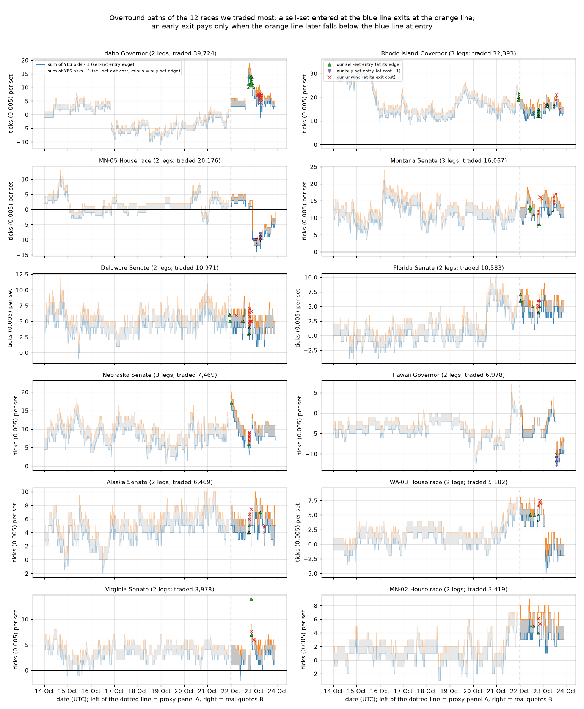
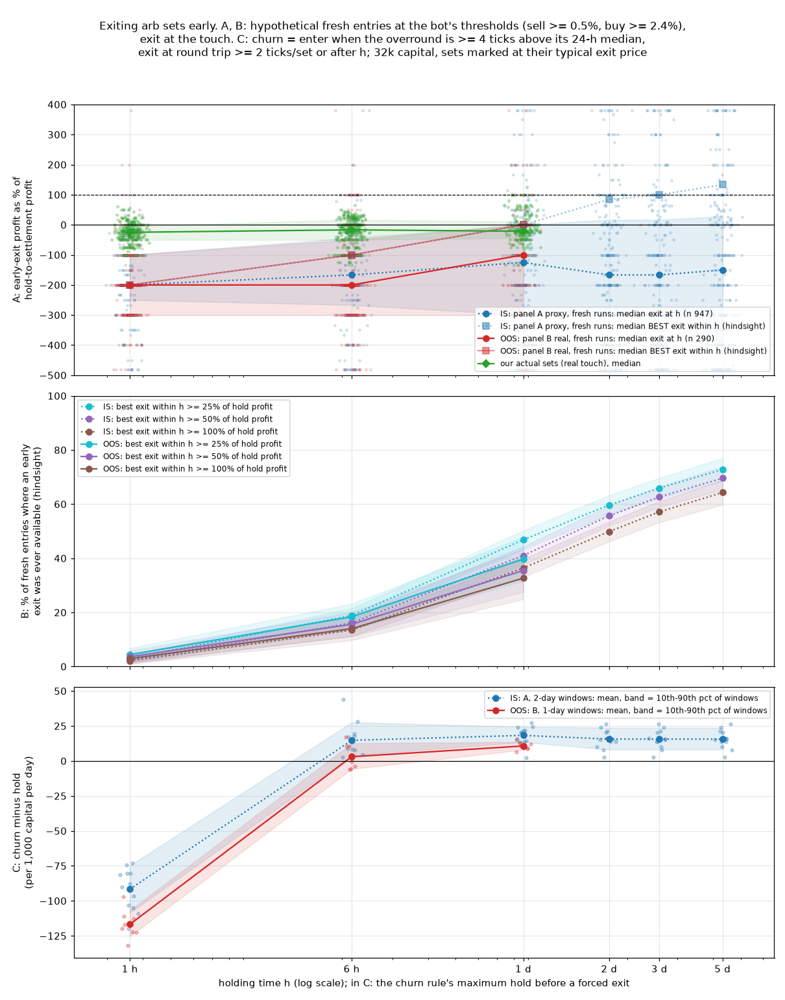
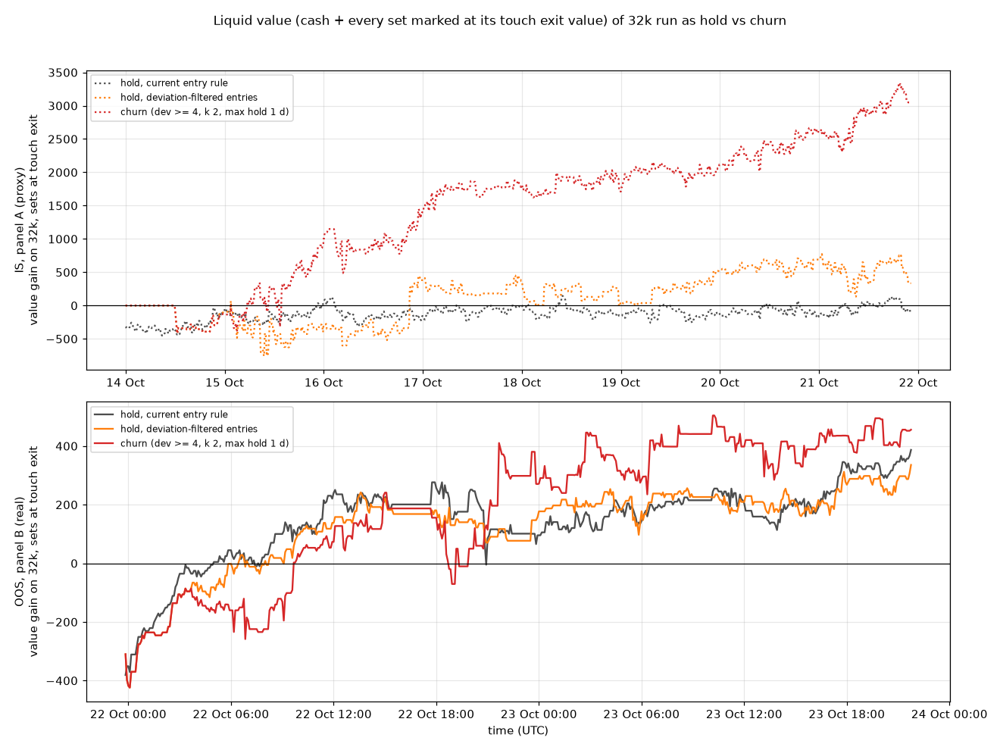

# Arb convergence: should we hold sets, or exit early and re-deploy? (research, 23 Oct 2026)

Read-only study. Nothing under `sigbot/`, `config.json`, `params/`, `tests/` or `deploy/` was touched, the bot was not
stopped, no orders, **0 venue API reads** (everything is local data). Script: `research_notes/arb_convergence_study.py`;
outputs in `data/research_arb_convergence/` (tables.md, results.json, race_day_overround.csv, race_paths_30min.csv);
figures `research_notes/figures/arb_convergence_paths.png`, `arb_convergence_horizon.png`, `arb_convergence_strategy.png`.

## Bottom line

* **Exiting an ordinary arb early loses money.** A typical 2-leg race has a sell edge of 1 tick (sum of bids - 1) and a
  sell exit cost of 3 ticks (sum of asks - 1), because each leg has a 1-tick spread. A set bought at the bot's threshold
  and sold back a day later returns a median of **-100% of its hold-to-settlement profit** on real quotes (OOS; -125% on
  the 7.9-day proxy panel). With perfect hindsight, the best exit within 1 day reached 50% of the hold profit for only
  35% of fresh entries. For 1-tick entries (two-thirds of them) the median is -200% at every horizon.
* **Overround does converge, but only the part above the race's normal level.** Each race has a stable overround level
  (2-leg median 2 ticks of mid sum, 3-leg 11-13 ticks). Deviations from that level have a standard deviation of about
  1-2 ticks and a **half-life of 2-5 hours**: the 6-hour persistence is 0.27 on real quotes and 0.54 on the proxy, and
  at 12 hours it is about 0. Nothing converges toward payout. The RI Governor finding in election_night_capital_plan.md
  holds: 3-leg sets cost 11-17 ticks to exit at any time.
* **Under the cash objective, holding is worth about nothing too.** On 3 Nov every set has to be sold back at its normal
  exit cost. Hold at the current thresholds gained +142 on 32k over 7.9 days (proxy) and +265 over 1.9 days (real),
  with every set marked at its typical exit price. On a settlement basis the same books show +1.2k and +1.3k. Cash mode
  (no new sets) was the right call for plain arbs.
* **The only churn that pays is a deviation trade.** The rule: enter only when a race's overround is >= 4 ticks above
  its own trailing 24-h median, exit when the round trip reaches +2 ticks per set, and force an exit after 24 h. It was
  chosen in-sample (IS) out of 36 variants. Out-of-sample (OOS) on real quotes it beat hold by **+5 to +11 per 1,000
  of capital per day** (+0.16k/day on the full 1.9-day panel, +0.34k/day averaged over rolling 1-day windows, +0.04k/day
  if the books are marked at the end-of-window touch). IS on the proxy it beat hold by +15/1k/day, about +10 after
  correcting for proxy noise, which inflates the gain about 1.5x.
* **Expected value to 3 Nov 18:00 ET on the 32k book:**

  | strategy | expected | range |
  |---|---|---|
  | (A) hold | about 0 | ±0.3k |
  | (B) deviation churn | **about +2k** | +0.3k to +3.5k |

  Zero cannot be excluded: there is only 1.9 days of real OOS data, about 2 independent samples. Doubling capital to
  64k adds only about 50%, because capacity binds.
* **Verdict: do not churn the ordinary arbs, and do not buy them under the cash objective. The deviation-churn sleeve is
  a small positive. Paper-trade it for 48 h before going live** (rule and criterion in section 7). It needs Sizhe's
  OK because it buys sets with cash, although it is flat by 3 Nov.

## Definitions and formulas (n legs; sb = sum of YES bids; sa = sum of YES asks; tick = 0.005)

| | entry cost | payout | hold profit P | exit proceeds at t1 | round trip R (exit at t1) | exit cost (vs payout) |
|---|---|---|---|---|---|---|
| sell-set (NO on every leg) | n - sb0 | n - 1 | sb0 - 1 | n - sa1 (buy YES at the asks; YES+NO redeem 1) | **sb0 - sa1** | sa1 - 1 |
| buy-set (YES on every leg) | sa0 | 1 | 1 - sa0 (minus third-party risk x) | sb1 (sell YES at the bids) | **sb1 - sa0** | 1 - sb1 |

* Early-exit share = R / P. It is 100% when the exit is as good as holding to settlement, and above 100% when the book
  flips past payout (sa1 < 1 for a sell-set: the free unwind). The brief's form (n-1) - (sa1 - 1) is the same as n - sa1.
* Under the cash objective, a set held to 3 Nov is worth n - sa(3 Nov). Holding to then is itself a round trip:
  R = sb0 - sa(3 Nov).

## Data

| panel | role | period (UTC) | prices |
|---|---|---|---|
| A | in-sample | 14 Oct 00:00 - 21 Oct 22:15 (7.9 d), 5-min grid, 117 races | proxy: each leg's last 5-min trade close from `data/candles_5m.json`, as a 30-min trailing median, ± the leg's median half-spread measured in B |
| B | out-of-sample | 21 Oct 23:50 - 23 Oct 21:25 (1.9 d), 5-min grid | real touch from `venue_quotes` (venue='sig'), forward-filled; grid points more than 10 min after the last poll are dropped (12% of points, Mac network outages) |
| our sets | | | `arb_trades` ok=1 (256 entry lots, 130 unwinds), FIFO-matched |
| touch sizes | | | `quotes` table bid_qty/ask_qty |

**Proxy calibration.** On B's period, I rebuilt the proxy from the tape table and compared it with the real touch.

* The level error of the race mid sum is 0 ± 1.1 ticks.
* 1-day changes correlate at 0.82 with the real ones. 6-hour changes correlate at 0.63. 1-hour changes are noise
  (0.05).
* The proxy therefore says little at 1 h and is usable at 6 h or more. It inflates hindsight-best and rule-trigger
  results.
* Running the chosen churn rule on the proxy of B gives +464 over hold, against +301 on the real quotes: the proxy
  inflates it by about 1.5x.

All thresholds and rules are chosen on A and tested on B.

## 1. How the sum of the contracts behaves (figure 1)

`arb_convergence_paths.png` shows the 12 races we traded most. Blue is sb - 1, the sell entry edge. Orange is sa - 1,
the sell exit cost; when it is negative, its size is the buy-set edge. Panel A is to the left of the dotted line and
panel B to the right. Our sell entries are drawn as ▲, buy entries as ▼ and unwinds as ×. A sell-set exited early makes
money only if the orange line later drops below the blue line at entry.

| panel | legs | races | median mid-overround (ticks) | median sb-1 | median sa-1 | sd of deviation from the race median | half-life of a deviation | 6-h persistence | sell-set qualifies |
|---|---|---|---|---|---|---|---|---|---|
| A (proxy) | 2 | 114 | 1.3 | 0.2 | 2.5 | 1.94 | 5.1 h | 0.54 | 50% of the time |
| A (proxy) | 3 | 3 | 11.0 | 9.5 | 12.5 | 2.72 | 2.9 h | 0.41 | 99% |
| B (real) | 2 | 114 | 2.0 | 1.0 | 3.0 | 1.05 | 2.7 h | 0.27 | 45% |
| B (real) | 3 | 3 | 13.0 | 11.0 | 15.0 | 1.85 | 2.1 h | 0.01 | 88% |

**Regime shifts happen.** On 22 Oct, Idaho Governor jumped from a buy-side state (sa - 1 about -4) to sb - 1 of 15. It
then compressed to 5 within a day. That one episode is where the bot's recycles made their money (section 3). MN-05,
Hawaii and WA-03 show the opposite moves. The per-race-per-day table is in `race_day_overround.csv`, and the 30-minute
paths for every race are in `race_paths_30min.csv`.

## 2. Hypothetical entries at the bot's thresholds (figure 2, panels A and B)

The entries are sell-sets with return >= 0.5% and edge >= 1 tick, and buy-sets with return >= 2.4% after x. A fresh
entry is the first 5-min point of a qualifying run; an outage does not start a new run. A second sample takes every
qualifying race once per hour. Exits are at the touch.

| panel | entries | h | n | median share at h | IQR | best within h, median (hindsight) | P(best >= 25%) | P(best >= 50%) | P(best >= 100%) |
|---|---|---|---|---|---|---|---|---|---|
| IS A | fresh | 1 h | 940 | -200% | -250 .. -100% | -200% | 3% | 2% | 2% |
| IS A | fresh | 6 h | 890 | -167% | -267 .. -43% | -100% | 19% | 16% | 13% |
| IS A | fresh | 1 d | 805 | -125% | -300 .. 0% | 0% | 47% | 41% | 36% |
| IS A | fresh | 2 d | 704 | -167% | -300 .. +18% | +86% | 60% | 56% | 50% |
| IS A | fresh | 3 d | 616 | -167% | -300 .. +17% | +100% | 66% | 63% | 57% |
| IS A | fresh | 5 d | 434 | -150% | -400 .. +29% | +133% | 73% | 70% | 64% |
| OOS B | fresh | 1 h | 273 | -200% | -300 .. -100% | -200% | 4% | 4% | 3% |
| OOS B | fresh | 6 h | 250 | -200% | -300 .. -50% | -100% | 18% | 16% | 14% |
| OOS B | fresh | 1 d | 141 | -100% | -300 .. 0% | 0% | 40% | 35% | 33% |
| IS A | hourly | 1 d | 10,249 | -50% | -133 .. 0% | 0% | 35% | 24% | 15% |
| IS A | hourly | 5 d | 4,412 | -48% | -150 .. +33% | +71% | 73% | 63% | 46% |
| OOS B | hourly | 1 d | 1,218 | -58% | -150 .. 0% | 0% | 28% | 21% | 15% |

**The exit price at a fixed time is bad. A good exit appears at some moment, but you only know it in hindsight.** The
proxy's long-horizon hindsight figures are inflated by its noise.

**Size of the entry matters (fresh entries, exit at 1 d):**

| panel | entry edge | n | median share at 1 d | mean round trip (ticks/set) | P(best >= 50%) |
|---|---|---|---|---|---|
| A | 1 tick | 615 | -200% | -1.85 | 41% |
| A | 2-3 ticks | 93 | -67% | -1.24 | 33% |
| A | >= 4 ticks | 97 | +18% | +1.12 | 48% |
| B | 1 tick | 111 | -200% | -1.77 | 32% |
| B | 2-3 ticks | 22 | -25% | -0.55 | 55% |
| B | >= 4 ticks | 8 | -17% | -0.50 | 25% |

**The non-hindsight rule loses on threshold entries.** The rule exits at the first touch where R >= k ticks, and
otherwise forces the exit at h. Its mean share is negative for every k from 0 to 8 and every h. On B at 1 d it ranges
from -95% (k 0, triggered 62% of the time) to -142% (k 8). Triggered exits are small wins; the forced exits at h are
the usual -1 to -2 tick losses. **No exit rule rescues a 1-tick arb**, because there is nothing to converge: its edge
is the normal overround minus the spread.

## 3. Our actual sets

These are the 256 entry lots in `arb_trades` (ok=1), with unwinds matched FIFO. The realised round trip is the entry
edge plus the unwind edge (the unwind edge is minus the walked exit cost).

| race | kind | sets entered | hold profit at entry | unwound | realised round trip | as % of the unwound sets' hold profit | median hold before unwind | left (ledger) | left: R if exited at the touch now |
|---|---|---|---|---|---|---|---|---|---|
| Idaho Governor | sell | 42,287 | 2,563 | 41,239 | **+1,241** | 50% | 9.5 h | 1,048 | +31 |
| Rhode Island Governor | sell | 16,881 | 1,369 | 4,575 | +3 | 1% | 38.7 h | 12,306 | -1 |
| MN-05 House | buy | 21,162 | 986 | 0 | | | | 21,162 | +457 |
| Montana Senate | sell | 8,276 | 485 | 8,275 | -154 | -32% | 3.1 h | 1 | |
| Hawaii Governor | buy | 7,401 | 423 | 0 | | | | 7,401 | +53 |
| Delaware Senate | sell | 11,242 | 271 | 10,166 | -42 | -17% | 7.5 h | 1,076 | -11 |
| Florida Senate | sell | 10,850 | 267 | 9,498 | -23 | -10% | 0.9 h | 1,352 | -11 |
| Nebraska Senate | sell | 3,864 | 259 | 3,864 | +102 | 39% | 18.4 h | 0 | |
| Virginia Senate | sell | 4,199 | 221 | 4,199 | +78 | 35% | 2.5 h | 0 | |
| 26 other races | | 51,534 | 1,222 | 46,490 | -196 | | | 5,044 | +2 |
| **total** | | **177,696** | **8,068** | **128,306** | **+1,009** | **18%** | | **49,390** | **+525** |

* **Recycling realised +1,009, 18% of the hold profit of the sets it unwound.** Idaho alone gave +1,241, and it was a
  deviation trade: entered at an overround of 10-14 ticks, unwound at about 6. Without Idaho, recycling realised -232.
  (Under the settlement objective, recycling was judged by locked edge gained: +744 net on 23 Oct, per the daily brief.
  Under the cash objective, the round trip is what counts.)
* Our lots at the touch: the hold-profit-weighted share is -6% at 1 h, +7% at 6 h and +22% at 1 d. The best exit
  within 1 d was worth 45% of the hold profit. Our lots did better than hypothetical threshold entries because the
  biggest ones (Idaho, Nebraska, RI) were bought at high deviations.

## 4. Capacity and turnover

| panel | kind | fresh runs | per day | per day with edge >= 3 ticks | duration in min, p50 / p75 / p90 | median entry edge |
|---|---|---|---|---|---|---|
| A | sell | 842 | 106 | 2 | 165 / 594 / 1,644 | 1 tick |
| A | buy | 105 | 13 | 13 | 55 / 170 / 480 | 5.5 ticks |
| B | sell | 279 | 146 | 6 | 55 / 398 / 846 | 1 tick |
| B | buy | 11 | 6 | 6 | 20 / 68 / 510 | 7 ticks |

* Fresh threshold arbs are plentiful: about 100-150 per day across 75-106 races. But they are 1-tick spread-crossings.
  Only 2-13 a day have an edge of 3 ticks or more.
* With the deviation filter (>= 4 ticks above the race's 24-h median), about 40 (race, side) pairs qualify per day, and
  about 3 races qualify at any moment.
* **Touch size.** At run onset, the smaller leg's touch was 600 sets at the median (p25 283, p75 780; only 17 runs had
  both legs in the `quotes` table). The DMM refills in about 3.7 s (bot_exploits.md), and the bot did fill 42k Idaho
  sets in 6 h.
* **What churn can absorb.** In the simulator it cycled 219k of turnover in 1.9 days on 32k. Cutting the clip to 500
  sets per step lowered the OOS excess only from +157 to +132 per day. Doubling capital to 64k raised it only to
  +236 per day. **Capacity binds at about 30-60k.**

## 5. Hold (A) vs churn (B) simulations (figure 2 panel C, figure 3)

**Setup.**

* Capital: 32k, the current arb book at cost.
* Fills: at most 2,000 sets per race per 5-min step, each way, at the touch.
* Per-race caps: 15k (2-leg), 25k (3-leg), 40k (2-leg sets returning 4% or more).
* After an exit, a race cannot be re-entered for 30 min.
* Both strategies take free unwinds and redeploy the freed cash.
* Terminal value: every held set is marked at the race's typical exit price, the panel median. That is what a patient
  3 Nov exit gets if overround is stationary. The end-of-window touch mark and the settlement-basis value are also
  shown.
* IS windows: 12 rolling 2-day windows of A. OOS windows: 8 rolling 1-day windows of B. Both overlap.

**Hold, terminal gain per window (typical mark):**

| entry filter | IS per 2-day window | OOS per 1-day window | full A, 7.9 d (typical / settlement basis) | full B, 1.9 d (typical / settlement basis) |
|---|---|---|---|---|
| current thresholds | +77 [-180, +390] | +23 [-129, +168] | +142 / +1,175 | +265 / +1,279 |
| deviation >= 4 ticks | +464 [+123, +833] | +128 [-57, +400] | +605 / +1,767 | +339 / +1,054 |

**Churn minus hold (current rule), per 1,000 capital per day.** The first 6 rows are the IS ranking; the last 3 are the
plain-churn variants (no deviation filter).

| deviation filter | exit k ticks | max hold | IS | OOS | exits only (vs hold with the same filter), IS / OOS | full A / B gain (typical mark) |
|---|---|---|---|---|---|---|
| **>= 4** | **2** | **1 d** | **+18.3 [+13.4, +24.5]** | **+10.7 [+7.9, +13.6]** | +12.2 / +7.4 [-5.0, +16.4] | +3,918 / +566 |
| >= 4 | 1 | 1 d | +15.8 | +8.4 | +9.8 / +5.1 | +3,134 / +349 |
| >= 4 | 2 | none | +15.6 | +10.7 | +9.6 / +7.4 | +1,843 / +625 |
| >= 2 | 1 | 1 d | +15.1 | +7.3 | +12.0 / +4.2 | +4,210 / +682 |
| >= 2 | 2 | 1 d | +12.5 | +6.9 | +9.5 / +3.8 | +4,056 / +653 |
| >= 4 | 4 | 1 d | +11.0 | +6.3 | +4.9 / +3.0 | +2,580 / +623 |
| off | 1 | none | +3.7 | **-3.0** | | +749 / +160 |
| off | 2 | none | +3.5 | **-2.3** | | +1,212 / +171 |
| off | 0 | none | -0.5 | **-8.7** | | +428 / -232 |

* **Every deviation-filtered variant is positive OOS. Every unfiltered churn is zero or negative OOS.** That is the
  section 2 result again: the gain comes from mean reversion of deviations, not from churn itself.
* For the chosen rule on B, exits that reached k realised **+2.12 ticks per set** (+714; 67k sets; median hold 6.6 h).
  The forced 24-h exits realised -1.00 ticks per set (-117; 23k sets). The P&L was spread over many races: MN-05 +101,
  Wyoming Senate +80, MN Governor +69, U.S. House +60, Nebraska Senate +50, RI +45.
* **Panel C of figure 2 (maximum hold).** A forced exit after 1 h costs about -100/1k/day. At 6 h the rule is roughly
  break-even OOS (+3). At 1 d it is +11 OOS. Beyond 1 d the IS result is flat, at about +15.
* **How much the result depends on the mark.** Over the full B panel, churn beat hold by +301 with the typical mark
  (+158/day). With the end-of-window touch mark the margin was only +69 (+36/day). Figure 3 shows why: both books gained
  about +750 from B's first-hour dip as the 22 Oct overrounds compressed. This is the weakest point of the evidence.

**Extrapolation to 3 Nov 18:00 ET.** That is 11.1 days from now. With a wind-down that stops entries 24 h before the
punt, entries run for about 10 days.

| | per day on 32k | to 3 Nov |
|---|---|---|
| (A) hold the current book (new_sets=false) | 0 | **about 0 ± 0.3k.** RI's exit cost is now at its 12th percentile in B (15 ticks vs a median of 17), worth about +0.12k if sold now rather than at a typical moment. Hawaii is at its 93rd percentile (10 vs 6 ticks), so waiting is worth about +0.15k. MN-05 is at its median. |
| (A') hold, buying new sets at the current thresholds | | +0.1 to +0.3k one-off (typical mark) |
| (B) deviation churn | +0.04k (OOS, touch mark) / +0.16k (OOS, typical) / +0.34k (OOS rolling) / about +0.31k (IS ÷ 1.5 proxy inflation) | **about +2k central, +0.3k to +3.5k.** 1.9 days of OOS cannot exclude 0. On 64k: about +3k. |

## 6. The current book (ledger remainder, about 49k sets)

| race | kind | sets | exit cost now (ticks/set) | percentile of now in B | B median | A median |
|---|---|---|---|---|---|---|
| MN-05 House | buy | 21,162 | 5 | 56% | 5 | 0 |
| Rhode Island Governor | sell | 12,306 | 15 | 12% | 17 | 17.5 |
| Hawaii Governor | buy | 7,401 | 10 | 93% | 6 | 5 |
| Florida Senate | sell | 1,352 | 6 | 66% | 6 | 2 |
| New Hampshire Senate | buy | 1,154 | 5 | 47% | 6 | -3 |
| Delaware Senate | sell | 1,076 | 5 | 27% | 6 | 6 |
| Idaho Governor | sell | 1,048 | 5 | 31% | 6 | -2 |
| California Governor | sell | 1,026 | 6 | 67% | 6 | 5 |

The ledger can differ from the venue's positions; the review tool's numbers take precedence. If overround is
stationary, the expected value of waiting until 3 Nov is (exit cost now - typical exit cost) per set. That is small
everywhere: RI favours exiting now, Hawaii favours waiting, and the rest are flat.

## 7. Verdict and the rule

1. **Do not churn ordinary arbs, and do not buy them under the cash objective.** Early exits of threshold arbs lose
   about one hold profit at the median. Holding them to a 3 Nov exit is worth about zero. Keep `new_sets=false`.
2. **Do not raise or lower the recycler's appetite on these grounds.** Recycling made money only on the Idaho deviation.
3. **Deviation churn is a small positive (+2k central by 3 Nov on 32k).** If Sizhe wants it, paper-trade first.
   Proposed implementation:
   * **Signal.** For each race, keep the trailing 24-h median of the mid overround, sum of (bid+ask)/2 - 1, sampled
     every 5 min. Require at least 12 h of samples.
   * **Entry.**
     * Sell-set: the bot's thresholds hold (sum of bids - 1 >= 0.005 and return >= 0.5%) **and** mid overround >=
       median + 0.020 (4 ticks).
     * Buy-set: thresholds hold (return >= 2.4% after x, edge >= 0.005) **and** mid overround <= median - 0.020.
     * Rank by return. At most 2,000 sets per race per 5 min at the touch. Per-race caps as config.
     * Sleeve capital 32k (64k adds only about 50%).
     * No re-entry within 30 min of an exit in the same race.
   * **Exit, the first of:**
     * round trip >= 0.010 (2 ticks) per set: sell sb_entry - sa_now >= 0.010, buy sb_now - sa_entry >= 0.010;
     * free unwind (exit value >= payout);
     * 24 h after entry, at the touch, all legs or none.
   * **Re-deploy.** Freed cash goes to the best candidate passing the filter at the next check.
   * **Wind-down.** No entries after 2 Nov 23:00 UTC, so that every churn set is cash by 3 Nov 23:00 UTC (18:00 ET).
   * **Legacy book (not backtested here).** Leave it under the existing rules. Optionally exit a legacy race when its
     exit cost is at or below the 25th percentile of its trailing 24 h; RI qualifies today.
   * **Paper criterion (48 h, live quotes).** All of the following:
     * paper churn minus paper hold >= +3 per 1k per day on the typical mark and >= 0 on the touch mark;
     * forced-exit losses < 30% of the gains from exits that reached k;
     * at least 30 exits.
   * Fails, or results in between: leave it off.
   * Per the double-check rule, a live build needs the failure-scenario test, the botctl precheck and a Fable review.

## Limitations

* **The OOS sample is short.** Panel B has 1.9 days of real quotes, about 2 independent rolling windows. The 2-5 day
  horizons exist only on the proxy panel, whose noise (±1.1 ticks) inflates hindsight and rule results by about 1.5x.
* **Fills are assumed.** Fills are at the logged touch, with no latency, no allOrNone rejection and no own impact. The
  DMM may lean against repeated hits. Touch sizes are observed for only 17 runs.
* **Polling misses short arbs.** The 5-min grid and the 60-120 s polls miss arbs that last less than a minute. Those
  are 1-tick spread-crossings, which section 2 shows are not worth churning.
* **The typical-exit mark assumes stationarity.** Regime shifts (Idaho, MN-05, Hawaii on 22-23 Oct) break it. On
  election-day eve, overround may widen as the DMM pulls back; that hurts both strategies, and hold more, because hold
  carries the whole book into 3 Nov.
* **Ledger holdings are approximate.** They come from `arb_trades` FIFO, which cannot see sets entered before the
  database.

## Reproduce

`<scratch venv with numpy+matplotlib>/bin/python research_notes/arb_convergence_study.py` takes about 40 s. It copies
the database and opens the copy read-only. `--figures` redraws the figures from `results.pkl`. The full generated
tables are in `data/research_arb_convergence/tables.md`.
