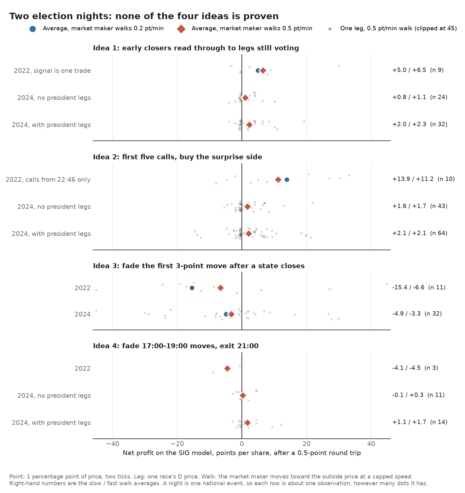

# Election-night directional tests: A2, A3, A6, A22 (31 Oct 2026)

## Verdict

**Do not trade any of these on 3 Nov. Two ideas are dead and two are unproven, and the two unproven ones are the same bet.**

| idea | verdict | effect (outside prices) | net on SIG, pts per share | nights agree? |
|---|---|---|---|---|
| 1. Poll-close read-through (A2) | **Unproven.** Right sign both nights, but the evidence is thin | Late legs moved -1.0 pt in 2024 and +4.6 pts in 2022, the same way as early legs | 2024 +0.8 to +1.1; 2022 +5.0 to +6.5 | Yes on the fixed test; no once the window changes |
| 2. First-called seats (A3) | **Unproven.** Right sign, but no better than the current price | Uncalled legs moved -1 to -2 pts in 2 h in 2024, and +10 to +11 in 2022 | 2024 +0.1 to +1.7, one version -2.4; 2022 +8 to +14 (thin) | Sign yes; size no; the 2022 test ran 3+ h later |
| 3. Count-order mirage (A6) | **Rejected.** First moves continued | Reversal at +3 h: -1.3 pts, so continuation. 28% gave back half | -2.8 to -14.8, fade loses | Yes, both continued |
| 4. Exit-poll rumour fade (A22) | **Rejected** for 2026 legs | Reversal to 21:00: +0.9 pts in 2024, -4.4 in 2022 | 2024 -0.1 to +0.3; 2022 -4.1 to -4.5 | No |

**How much evidence this is.** There are two nights, and a night is one national event. The best possible sign test on two
nights gives p = 0.25, so nothing here can be significant. Leg counts (up to 64) do not change that, because the legs moved
together.

**Ideas 1 and 2 are one bet: "the evening's early direction keeps going."** Both were right on both nights. They cannot be
counted as four wins, because it is the same two nights.

**The market maker's lag adds nothing to ideas 1 and 2.** Profit with no lag at all is about the same (2024, idea 1: +1.0
with no lag, +0.8 to +1.1 with it). The lag gives a better entry and a worse exit, and these cancel. So either the outside
price drifts, or there is no edge. This is not a lag trade.

**The size is small even if it is real.** At 2,000 shares a leg, a point on 29 late legs is about 580 S. A 2024-style night
for idea 1 pays about +0.6k S, and a 5-point wrong-way night costs about -2.9k S. All 29 legs are one national bet.

**Most useful thing to prepare:** record, read-only, from 18:00 ET on 3 Nov, the both-venue move of the early legs at 19:30
and 20:00, the late legs' outside moves after that, and SIG's mid on all of them. That gives a third night for ideas 1 and 2
and the first measure of the market maker's speed on large election-night moves, which is the number the other election
night work depends on. `election_night.py --record` already logs outside prices at 4-second polls without trading, but it
does not log SIG books, so that side must come from the bot's own tables. The election sleeve stays off.

*Each row is about one observation, however many dots it has.*

## What was tested

* **Definitions** were written to `data/research_diralpha/election/prereg.md` before any statistic was run. I had already
  read the earlier notes, so I knew who beat the prices each year (R in 2024, D in 2022). The count types for idea 3 were
  hand-coded in that file before looking.
* **2024:** 129 races, 1-minute Polymarket and Kalshi prices.
* **2022:** 17 usable races, Polymarket pool trades of $50 or more, so a price only changes when someone trades. No Kalshi.
  Treat every 2022 number as very rough. Its timing is the time of a trade, not the time of news.
* **2026 has no president legs,** so the main rows leave them out. Rows with them are shown because those legs are the
  cleanest data, but they do not carry over.
* **SIG model:** the mid walks toward the outside price at 0.2 or 0.5 pt/min. Round trip costs 0.5 pt (1 tick). No depth
  limit. Measured SIG behaviour on 2-3 pt moves is slower than this (0-12% copied by 30 min), so small-move numbers are
  generous.
* Code: `research_notes/dir_alpha/election_night_tests.py`. Output: `data/research_diralpha/election/results.json`.

## 1. Poll-close read-through (A2)

Early legs close by 19:30 (signal 19:00-19:30). Late legs close at 21:00 or later (move 19:30-21:00). Trade: at 19:30 buy
the early-move side on every late leg, exit at the leg's close.

| | early legs | early move | late legs | late move, mean | median | legs going the same way | late legs in the signal window | net on SIG: walk 0.2 / 0.5 / no lag |
|---|---|---|---|---|---|---|---|---|
| 2022 | 4 | +2.3 | 9 | +4.6 | +2.8 | 56% | +0.1 | +5.0 / +6.5 / +7.6 |
| 2024, no president | 9 | -1.2 | 24 | -1.0 | 0.0 | 42% | -0.1 | +0.8 / +1.1 / +1.0 |
| 2024, with president | 15 | -1.5 | 32 | -2.2 | -0.5 | 53% | 0.0 | +2.0 / +2.3 / +2.3 |

As a logit slope, that is about 2.0 in 2022 and 0.8 in 2024, each from a single point, since a night has only one national
signal.

* **2022's signal is one trade.** NH Senate moved +9.2 and the other three early legs did not trade in the window.
  Stretching the signal to 19:00-20:00 (chosen afterwards) flips it to -0.7 while late legs still rose +2.8.
* **2024's mean is three legs.** WI Senate, IA-03 and NE-02 make up about all of the net move. The median leg did not move.
  Polymarket and Kalshi agree separately (-0.8 and -1.5).
* **Within the night there is no reliable lead.** Every 5 min from 19:30 to 22:00, I regressed the next hour of late legs on
  the last 30 min of closed legs. Correlation was +0.17 in 2022 (placebo p 0.27) and -0.16 in 2024 (p 0.80); with president
  legs, +0.33 (p 0.10). That is under 3 independent hours per night.
* **Late legs did not move with early legs** in the same half hour. So the outside price had not repriced them at 19:30,
  which is the only encouraging part. It may equally mean the early move was noise.

## 2. First-called seats (A3)

Surprise = mean of (won by D minus pre-close D price) over the first k calls. Targets are uncalled legs, 0.05-0.95. Trade:
buy the surprise side, exit at the later of +2 h and the leg's close.

| no president | call time | surprise, pts | targets | +2 h | next-day noon | final result | net on SIG: walk 0.2 / 0.5 |
|---|---|---|---|---|---|---|---|
| 2024, k 3 | 19:00 | -0.7 | 42 | -1.9 | -4.5 | -5.2 | +1.1 / +1.4 |
| 2024, k 5 | 19:30 | -0.9 | 43 | -1.5 | -4.3 | -4.9 | +1.6 / +1.7 |
| 2024, k 10 | 20:00 | -0.3 | 42 | -1.2 | -4.0 | -5.9 | +0.4 / +0.4 |
| 2024, k 20 | 21:00 | 0.0 | 43 | -1.0 | -2.7 | -4.8 | +0.1 / +0.1 |
| 2024, competitive k 1 | 19:00 | +0.2 | 42 | -1.9 | -4.5 | -5.2 | **-2.1 / -2.4** |
| 2024, competitive k 3 | 21:00 | -2.4 | 43 | -1.0 | -2.7 | -4.8 | +0.1 / +0.1 |
| 2024, competitive k 5 | 21:23 | -4.4 | 41 | -2.5 | -3.1 | -4.2 | +0.4 / +1.4 |
| 2022, k 3 | 22:55 | +13.6 | 11 | +10.1 | +1.7 | +16.2 | +13.6 / +8.4 |
| 2022, k 5 | 23:21 | +7.6 | 10 | +10.9 | -0.2 | +15.8 | +13.9 / +11.2 |

* **The 2022 test is a different experiment.** The call file has no 2022 call times before 22:31, so it starts more than
  three hours later than 2024, after much of the count. It is not a test of first calls.
* **The early 2024 score is almost empty.** First calls are safe seats, so the surprise is under 1 pt. One competitive-call
  version got the sign wrong, because its two calls were IN Governor and a VT Senate leg priced near 0.91 (Sanders is an
  independent, so that price means little).
* **Better than the current price? No evidence.** I fitted the shift on one night and scored the other, for the 5 versions
  that exist on both nights. Two improved the score on both nights, and three did not. The fitted weight ran from -0.5 to
  +0.5, the limits of the search, so it is not stable.
* **Noon matters.** In 2022 the +16 to the final result was only about 0 to +2 by next-day noon, because AZ, NV and others
  were still counting. On SIG that is cash not freed by the close.

## 3. Count-order mirage (A6)

First 3+ pt move within 60 min of the state's close. Reversal is how much came back. Fade: enter once SIG has copied half,
exit 150 min later. Averages are per state and year.

| group | legs | state-years | first move | reversal +1 h | reversal +3 h | gave back half | net on SIG: walk 0.2 / 0.5 |
|---|---|---|---|---|---|---|---|
| all | 46 | 36 | 5.6 | +0.3 | **-1.3** | 28% | -6.7 / -3.0 |
| 2022 | 12 | 10 | | | -2.6 | 17% | -14.8 / -3.5 |
| 2024 | 34 | 26 | | | -0.7 | 32% | -4.1 / -2.8 |
| both venues moved (2024) | 13 | 12 | 3.9 | -0.5 | -4.2 | 15% | -4.9 / -3.9 |
| no president | 28 | 26 | 6.1 | +0.5 | +0.5 | 36% | -9.2 / -2.5 |
| the predicted mirage direction | 14 | 12 | 6.8 | +3.8 | -6.0 | 21% | -10.6 / -6.7 |
| late mail D (PA, WI, MI, VA) | 12 | 7 | 7.3 | -1.9 | -4.7 | 25% | -10.7 / -5.4 |
| early votes D first (NC, OH, IA, TX, FL, GA, AZ, NV, NM) | 17 | 13 | 5.2 | +1.3 | -0.8 | 29% | -8.1 / -2.3 |
| slow West | 6 | 5 | 6.6 | +3.4 | +5.1 | 50% | -4.6 / +1.4 |
| fast, other | 11 | 11 | 4.5 | -1.0 | -2.6 | 18% | -3.8 / -4.0 |

* **First moves went toward the eventual winner 72% of the time.** The moves that both venues share, which are the ones SIG
  copies, continued most.
* **The classic mirage only tracks who won.** In the late-mail states, moves toward R came back 23 pts in 2022 (2 legs) and
  ran a further 29 pts in 2024 (5 legs). Fading them was a bet on the national result.
* **Slow West is the only positive row.** It has 6 legs, and I would not build on it.
* **Prices gave back 10.5 pts at some point in the 3 h on average,** so these paths are violent. A short-stop fade was not
  tested.

## 4. Exit-poll rumour fade (A22)

Legs not yet closed; 17:00-19:00 move against 19:00-20:00 and 19:00-21:00. Events are moves of 2+ pts.

| | legs | events | event size | reversal to 20:00 | reversal to 21:00 | slope to 21:00 (t) | net fade to 21:00: walk 0.2 / 0.5 |
|---|---|---|---|---|---|---|---|
| 2022 | 12 | 7 | 3.5 | -1.5 | -4.4 | +1.3 (3.8, 5 legs) | -4.1 / -4.5 |
| 2024, no president | 45 | 23 | 5.9 | +0.4 | +0.9 | -0.1 (-0.7) | -0.1 / +0.3 |
| 2024, with president | 68 | 28 | 5.5 | +0.9 | +2.4 | -0.2 (-1.3) | +1.1 / +1.7 |

* **The nights disagree.** 2024 shows a small fade and 2022 shows momentum.
* **The 2024 sample is dirty.** Several events are stale prints, not rumours (CT Senate +18.7, VT Senate +16, PA-08 +19.5).
  Keeping only legs where both venues agree within 5 pts leaves 6 non-president events, net about zero.
* **The only signal is in president legs.** That clean sample has 14 legs and a slope of -0.5 with the night's mean removed
  (t -3.5), net +2.2 to +3.0. It is one night, those legs are close to one question, and 2026 has no such legs.

## What it could be worth on SIG

Sizing: 29 competitive legs have a first close of 21:00 or later today, the median SIG touch is about 1,200 shares, and the
ladder model is 2,000 per tick. At 2,000 shares a leg, 1 pt is 20 S per leg, or 580 S across all 29.

| idea | 2024-like night | 2022-like night | my view of expected value |
|---|---|---|---|
| 1 | +0.6k S | +2.9k S | 0 to +1k S, with -3k S plausible |
| 2 | up to +1.9k S (about 60 legs) | not believable | same bet as 1, so do not add it |
| 3 | loses | loses | negative |
| 4 | about 0 | loses | zero or negative |

The early-leg set is weaker in 2026 than these tests imply. Of the competitive SIG legs closing by 19:30, all 17 close at
19:00. They are House seats and FL, GA, NH, SC and VT state races. NC Senate is at 0.97, and the panel has no Ohio legs.

## Limits and changes from the fixed plan

* **The "competitive" filter let stale legs in** (0.05-0.95 on a stale print). I added a stricter rule afterwards: both
  venues priced and within 5 pts. It leaves almost no 2024 non-president legs for ideas 1 and 2 (0 early legs for idea 1),
  so it is usable only as a check. With president legs it gives idea 1 a cleaner look: -2.0 early, -4.1 late, 8 of 9 legs
  the same way, net +3.8 to +4.1. Those legs are nearly one race.
* **The 19:00-20:00 signal in idea 1 was chosen afterwards** and is labelled as such.
* **About 40 summary rows were produced** across the four ideas, so expect some to look good by chance.
* **Not modelled:** SIG's compression of prices, depth beyond the touch, the market maker pulling quotes, or our own impact.
* **House calls are missing** from the call file, so an already-called House seat can count as uncalled in idea 2.
* **Checks:** Polymarket and Kalshi agree separately on idea 1 in 2024, and WI Senate was checked by hand against raw Kalshi
  prices. No outside reviewer has read this.

No orders, no bot or config changes, no SIG API calls, no new data fetched.
