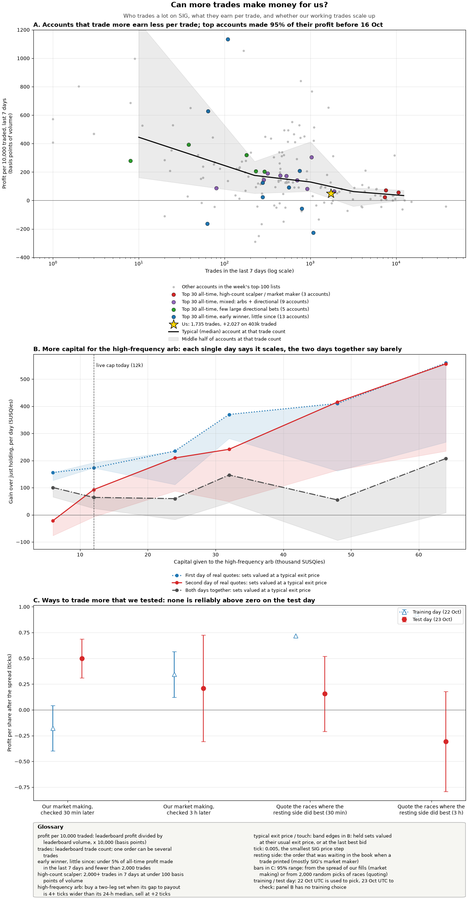

# More trades: what the leaders do, and which extra trades are positive EV (research, 24 Oct 2026)

Sizhe: "we should be doing more trades ... a lot of the top are doing way more trades than I am. Look for any way to
make trades that are positive EV."

Read-only. Script: `uv run --with numpy --with matplotlib python research_notes/more_trades_study.py` (`--fetch` redoes the
9 leaderboard reads; `--capacity` reruns the arb capital sweep). Data: `data/research_more_trades/`. Venue reads used: 9
(leaderboard, periods all/7d/1d x sort volume/trades/pnl, top 100 each, 23 Oct 23:2x UTC).

## Bottom line

* **Trade count is not why the leaders lead.** All 237 legs opened at 0.5, and no market has been listed since 18 Sep.
  The top 30 have made 8.77M all-time but only 423k (4.8%) in the last 7 days. The top 4 made 93-99.7% of their 840k-1M
  before 16 Oct, which looks like taking the opening mispricing. That can't be repeated.
* **Accounts that trade more earn less per unit traded** (panel A). Among the week's top-100 lists, median profit per
  10,000 traded is 427 bp at < 100 trades a week, 129 bp at 500-2,000, 62 bp at 2,000-5,000 and 24 bp at 5,000+. The
  three top-30 high-count accounts (7-10k trades a week) earn 55 bp pooled. **We earn 50 bp** (+2,027 on 403k, 1,735
  trades): the same rate per unit as the high-count leaders. They make more because they trade about 10x the volume
  on about 10x the capital.
* **Capital binds, not ideas.** At the last cycle the bot held 15k cash and 87k in positions (mostly arb sets). The
  high-frequency arb (12k cap) already takes most of the free cash. Of everything tested, only one trade made money
  out of sample, and it is the one already live: the high-frequency arb (+5 to +11 per 1k of capital per day,
  arb_convergence.md).
* **No new trade type clears the bar** (out of sample t > 2 net of the spread). Verdicts are below. The only "build"
  is conditional: scale the high-frequency arb once its own live results confirm the backtest.

## 1. What the high-volume accounts do

Style labels come from 7-day vs all-time leaderboard numbers. Win rate is the same in every period, so it is an
all-time statistic and was not used.

| style (top 30 all-time) | accounts | 7-day profit | 7-day trades | 7-day volume | profit per 10k traded |
|---|---|---|---|---|---|
| early winner, little since (< 5% of profit this week, < 2k trades) | 13 | +48k | 3,976 | 9.4M | 51 bp |
| high-count scalper / market maker (2k+ trades, < 100 bp) | 3 | +86k | 25,595 | 15.7M | 55 bp |
| mixed arbs + directional | 9 | +191k | 6,185 | 14.1M | 135 bp |
| few large directional bets (< 300 trades, 150+ bp) | 5 | +98k | 748 | 4.0M | 242 bp |

The best weekly earners are the mixed and directional accounts: +57k on 1,028 trades, and +51k on 232 trades. The
high-count accounts are steady (+40k on 10.6k trades, +38k on 7.6k trades) but earn only 24-72 bp. One account made
+32k in a single day on 54 trades, which is a directional punt.

**Tape (22-23 Oct, 74k prints, 22M SUSQies traded, all 237 legs):**
* Prints of 5k+ shares are 1.3% of prints but 48% of volume. Most of them came in two whale episodes, each about an
  hour long, on safe-seat favourites. MN-05 D was sold from 0.965 down to 0.87 (140 big prints, 22 Oct 22:00 UTC), and
  Hawaii Governor D got the same (59 big prints, 23 Oct 13:00 UTC). MN-05 alone is 23% of venue volume, and the top 10
  races are 56%. Our MN-05 and Hawaii buy-sets came from exactly these episodes, so the arb already collects them.
  Fading them directionally was tested before and lost (directional_impact.md: out of sample -0.48 tick, t -3.7;
  hft_tactics_2.md B: fade -1.3 ticks).
* Competitor set arbs are small. Same-size prints on both legs of a 2-leg race within 2 s happen 15x more often than by
  chance (2,768 pairs vs 184 with one leg's clock shifted 120 s), but they are only 3.2% of volume, and only about a
  quarter look like set arbs (both legs bought below payout). Other bots trade in fixed clips of 1, 100, 120, 140, 150,
  200 and 1,000 shares. flow_patterns.md already found that none of these flows can be exploited.

## 2-3. Candidates and tests

The time split is 22 Oct UTC for training and 23 Oct UTC for testing. Ticks are 0.005, and all figures are per share
after the spread.

| # | candidate | hypothesis | result (train → test) | stat | capacity | fits 3 Nov cash? | verdict |
|---|---|---|---|---|---|---|---|
| 1 | **Scale the high-frequency arb** (12k → 24-32k) | the edge we have is capacity-limited | Re-simulated on real SIG quotes (the rule was picked on other data). Gain over holding, per day, typical mark: 12k +64, 24k +60, 32k +147, 64k +207 over both days. Single days: 12k +173/+93, 32k +370/+241. Touch mark: 12k +24, 32k +45 | not monotonic over the full window; 2 days only | the original study saw capacity bind at 30-60k | yes: entries stop 1 Nov, flat by 3 Nov 22:30 UTC | **paper → build on evidence** (rule below) |
| 2 | Size up our market making | scale what works | 30 min: -0.29 → +0.50 (n 195 / 35). 3 h: +0.34 → +0.21. All days: -0.12 at 30 min (n 254), +0.21 at 3 h (n 180) | sign flips by day and horizon; fills cluster, so the t-stats are optimistic | ~22k shares over 3 days | yes | **drop for now**: backlog item 5's gate (>= 0 for 48 h at 30 min) is not met |
| 3 | Quote more markets, picked by where the resting side earns | some races pay passive liquidity more | Venue-wide, the resting side earns +0.22 → +0.35 at 30 min, but by race the ranking does not persist: Spearman -0.01 (30 min), 0.00 (3 h). Top-fifth races minus the rest in test: +0.16 (perm p 0.22), -0.31 (p 0.88) | p 0.22 / 0.88 | - | yes | **drop**. The resting edge goes to the DMM, which is first in the queue; ours is -0.12 |
| 4 | Copy the high-count style (many small trades at ~55 bp) | volume x margin | We already earn 50 bp on our volume. More volume needs capital, and the 15k of free cash is already used by the high-frequency arb (12k cap), which earns more per unit (+5-11 per 1k per day vs ~5.5 at 55 bp and 1 turn a day) | - | capital-bound | yes | **drop** (no edge beyond what we do) |
| 5 | New-market sniper (buy toward the outside fair when a market lists at 0.5) | the leaders' opening edge | 0 listings in 36 days | - | huge if it happens | yes | **paper: alert only** (log new exchange ids each cycle; no orders) |
| 6 | Fade or ride whale episodes | one seller dumps a safe favourite | covered by directional_impact, long_vol, hft_tactics_2 B: all negative | t -3.7 | - | - | **drop** (the arb already gets the set side) |
| 7 | Buy fast-count favourites before the night, sell at the call | they pay before stage 2 of the punt | the same as the election-night sleeve and punt plan (election_night.md, punt_strategy.md); competes with stage 1 for 18:00 cash | - | - | partly | **no new verdict**: belongs to the punt plan |
| 8 | Favourite-underdog pair through the call; thin late-night books; resting in DMM ladder gaps | | tilt_funding.md (zero marks), hft_tactics_2 C (slot ranking unstable, p 0.65), volume_target #7 (no gaps) | | | | **drop** (already tested) |

## 4. Ranking by expected SUSQies before 3 Nov, and the one rule

1. **High-frequency arb scale-up, about +0.3-1k if it works** (central about +0.5k; it could be 0). Rule: after
   48 h of live trading with at least 20 exits, if realised gain is >= +5 per 1k of capital per day on the touch mark
   (grep CHURN in data/live.log, arb_trades), raise the cap from 12k to 24k. Fund it only by unwinding **late-call** sets
   whose walked exit cost is at or below that race's median exit cost (arb_convergence.md section 6). Early-call sets are
   held for election night. This needs Sizhe's go under decision 00b, because it is an unwind. Under the "everything
   for the punt" target these sets get sold by 3 Nov anyway, and overround has been stationary, so selling now costs
   about the same as selling later. Keep the 4k per-race cap and the 1 Nov entry stop. If live results come in under
   +5/1k/day, leave the cap at 12k.
2. New-market alert: about 0 expected, but cheap and has a large upside. Paper only.
3. Everything else: 0 (drop).

**Honest answer to "more trades":** at our capital, more trades of the kinds we can find do not add positive EV. Per
unit traded we already match the high-count leaders. Their extra profit comes from 10x the capital and the opening
weeks, not from a trade type we are missing.
