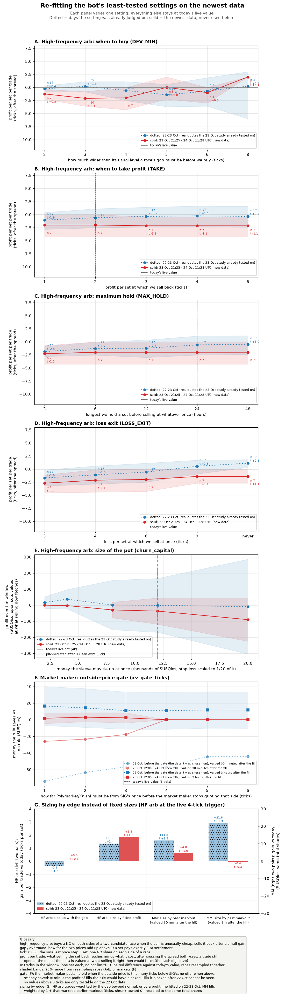

# Parameter audit: what was never fitted, what is stale, and re-fits on the newest data (24 Oct 2026)

Read-only audit. `config.json`, code, `params/` and the bot were not touched; no commits; **0 SIG API calls**. Script
`research_notes/param_audit_study.py` (modes: none = full replay, `events`, `gate`, `catchup`, `sizing`, `figure`; run
with `nice -n 5` and a Python that has numpy/matplotlib). Outputs `data/research_param_audit/*.json`. Figure
`research_notes/figures/param_audit_refits.png`. Inline-constant inventory (file:line for every hard-coded number):
side-session notes `param-audit-inline-inventory.md`. Independent adversarial review: section 6.

**Data.** `venue_quotes` (SIG, Polymarket, Kalshi touch, polled about once a minute) 21 Oct 23:49 - 24 Oct 10:40-11:40 UTC (the database grew while the modes ran);
`venue_fair`; 405 MM fills; `arb_trades`; `quotes` (touch sizes for quoted markets). `data/books_history/` holds only 4
hourly snapshots (from 23 Oct 23:17), too few for a depth re-fit; depth is taken from `quotes` touch sizes instead.
* **IS (in sample)** = 21 Oct 23:50 - 23 Oct 21:25: the real-quote panel the 23 Oct studies already used as their test.
* **OOS (out of sample)** = 23 Oct 21:25 - 24 Oct ~11:00 (13-14 h): data no study has seen. It is short, and it is a quiet
  Friday night and Saturday morning: zero catch-up signals, the HF-arb gap-movement ratio 0.52-0.72.
* t-statistics are paired against today's value, clustered by race (HF arb) or market (MM). The bar for a recommended
  change is a clear OOS improvement, **t > 2**.

## Bottom line

1. **Only one setting clears t > 2 on data that was not used to choose it, and only on 4-5 events: the
   high-frequency arb's LOSS_EXIT** (see 2). Everything else is "keep", "no evidence" or "do not take the planned
   step". The 13 h of new data are too few and too quiet: in that window every HF-arb trade but two was still open.
2. **High-frequency arb (dev_churn): expected value indistinguishable from zero on real quotes. The one component with
   a measurable cost is the 6-tick loss exit added on 24 Oct.**
   * Live rule, in sample (22 Oct 11:50 - 23 Oct 21:25, n 17): **-0.6 tick per set per trade on the 5-min grid, +0.1 on
     a 60-s grid.** The live loop runs every 30-60 s and catches transient +2-tick takes that 5-min points miss (Fable
     reproduction). The grid alone moves the result by 0.7 tick, as much as most sweep effects.
   * Out of sample there is **no evidence either way.** The "-1.8 to -2.0" in panels A-D is 2 closed trades (IA-02 +2,
     NH-01 -8) plus lots entered 0.2-3 h before the data ends, marked at the spread. With data to 11:33 UTC all 5 OOS
     lots are open.
   * Reconciliation with arb_convergence.md: its +2.12 is take exits only; its all-exits figure on the same window was
     +0.66 per set. Without the loss exit this replay gives +1.1 (5-min) / +1.7 (60-s grid). The gap between the study and
     the audit is the loss exit, plus medians starting 22 Oct 11:50, no buy-sets, one lot per race, and the big-holding
     exclusion.
   * **LOSS_EXIT 6 ticks → candidate change, the main session's call.** It was set on 24 Oct from a failure-scenario
     review, not from data, so the 22-23 Oct quotes are unseen for it. There, no loss exit gives **+1.1 vs -0.6 per trade
     (t +2.1 on both grids)**. In the 4 trades it closed (Idaho Gov, Wyoming Sen, FL-20, NH-01: -6 to -9 ticks, 0.1-0.6 h
     after entry, the gap widening a further 3-6 ticks), the set later recovered to +2 / -3 / +1 / +1. OOS has the same
     sign (t +1.1; closed trades only +2.0 vs -0.5). It is 4-5 events. The exit is also a stop protector, so the
     suggested change is to **widen it to 9 ticks** (IS +0.5, t +1.8; OOS the same as no exit), not to remove it. Risk
     check: 2 lots × 2,000 sets × 9 ticks = -180, close to the -200 sleeve stop.
   * **Keep MAX_HOLD 24 h** (confirmed on both grids: 3 h t -2.4 to -2.8, 6 h t -1.7 to -3.0, 12 h t -2.7 to -3.0).
   * **Pot (churn_capital): the data say nothing about pot size, so the step to 12k has no support.** With the stop at
     1/20 of the pot, the replay gives 4k +35, 12k -38. But at 4k the pot happened to be full when the losing races
     signalled, and 7 IS lots filled it through the OOS window. The ranking is luck of timing, not evidence that 4k is
     best. With the sleeve's edge indistinguishable from zero, a 3x pot triples the variance for no measured gain.
   * DEV_MIN 4 ticks and TAKE 2 ticks: no alternative is better (|t| < 1.8). The volatility pause never fires on this data
     (ratio 0.52-1.12 against 1.5), so VOL_PAUSE / VOL_RESUME are untested.
3. **The market maker's outside-fair gate (3 ticks): keep, re-test with 6-h marks.** On its own fit-period fills (22 Oct,
   before it was wired), the fills it would block made money at 30-minute marks (gate effect -57, t -5.6, concentrated
   in a few markets) and saved +11 at 3 h (t +1.0). On new fills, no threshold beats 3 with t > 2. The gate exchanges
   30-minute markout for 3-6 h convergence. MM inventory is held a median 3.7 h (9% closed within 30 min, 25% within
   3 h), so the 3-h mark is the right one, and nothing clears t > 2 there.
4. **Trade sizing (Sizhe's question).** Arb baskets and recycles already walk the book level by level down to the
   break-even. No other sleeve does. But no edge- or depth-scaled rule clears t > 2 OOS on the data available:
   * HF arb: profit falls as the gap moves further beyond its usual level (slope -1.1 to -1.4 tick per tick). Sizing
     up with the deviation is therefore worse (IS t -1.9; the slope rests on 17 points and leans on Idaho). A rule fitted
     on IS that sizes down the biggest spikes reaches OOS t +2.1 at a 2-tick trigger (not live). That is a nominal
     exception to the t > 2 bar, set aside: two fitted parameters, n 18 with 13 trades still open. At the live trigger
     it is t +1.3.
   * MM: sizing each market by its own past 30-minute markouts reaches raw OOS t +2.4. Most of that is simply more
     shares (+25%) at a positive 30-minute markout; with the share count held fixed it is t +1.0 at 30 min and t -0.3 at
     3 h. No change.
   * Catch-up and cheap favourites size at the touch with fixed notionals. The catch-up sleeve had 0 signals in the OOS
     window at live thresholds (0 live trades so far), so its sizing cannot be tested.
5. **Where the P&L to 3 Nov actually is.** Cash is 9.7k of 102.3k account value (cycles, 24 Oct 11:26 UTC). The
   sleeves audited here move tens of SUSQies a day: MM about +60/day at 30-minute marks and about 0 at 3 h; HF arb about
   +15/day at best. The settings that matter for liquid cash on 3 Nov belong to the unwind/cash-raise routine, which
   is not yet in code. Its exit-cost thresholds should get this re-fit treatment once it exists.

## 1. Parameter table

Priority: 1 = re-fit first. It combines the expected P&L impact to 3 Nov 18:00 ET (cash objective) with how cheap a
re-fit is. "Inert" = not reached by any live path today (cash mode, sleeve off, or a cap that never binds).
"Newer data would move it?": a judgement call, made only where this audit or the shadow tuner ran a re-fit.

### High-frequency arb (`sigbot/proposals/dev_churn.py`, config `churn_*`)

| parameter | value (where) | provenance (study, data window) | newer data would move it? | priority |
|---|---|---|---|---|
| DEV_MIN | 0.020 = 4 ticks (dev_churn.py:25) | arb_convergence.md: best IS of 36 variants on a proxy panel (trade prices, 14-21 Oct); grid had only 2 and 4 ticks; OOS 1.9 d real quotes | **re-fitted here**: no value better (Panel A); the sleeve's edge is indistinguishable from 0 | **1** |
| TAKE | 0.010 = 2 ticks (:26) | same grid (k 0/1/2/4) | **re-fitted**: flat 1.5-6 ticks, no t > 2 (B) | 1 |
| MAX_HOLD | 24 h (:27) | same grid (1 h, 6 h, 1 d, none) | **re-fitted**: keep; shorter worse IS t -2.4/-2.7 (C) | 1 |
| LOSS_EXIT | 0.030 = 6 ticks (:40) | judgement (Fable failure-scenario review, 24 Oct 01:04 UTC): 22-23 Oct data unseen for it | **re-fitted**: "never" +1.1 vs -0.6 IS (t +2.1, both grids), OOS same sign t +1.1: **candidate: widen to 9 ticks** (D) | **1** |
| churn_capital (pot) | 4,000 (config.json) | judgement (Sizhe: launch small); 12k planned after 3 clean exits | **re-fitted**: uninformative (timing luck decides the ranking); no support for 12k while the edge is ~0 (E) | **1** |
| churn_kill | -200 (config.json) | judgement; -600 planned with 12k | scales with pot; 1/20 used in the replay | 2 |
| per-race cap | 4,000 (DevChurn per_race default, not in config) | judgement | with a 4k pot, any value >= 2k is inert | 3 |
| MAX_SETS_PER_ENTRY | 2,000 (:30) | judgement | replay with touch depth: median entry is depth-bound (~600), not by 2,000 | 3 |
| ENTRY_GAP / REENTRY_GAP | 5 min / 30 min (:28-29) | judgement (study used a 30-min cooldown) | not tested; low impact | 4 |
| MIN_HISTORY / MIN_SAMPLES | 12 h / 144 (:31-32) | judgement | no | 5 |
| VOL_RECENT / VOL_BASE / VOL_PAUSE / VOL_RESUME | 6 h / 72 h / 1.5 / 1.2 (:35-38) | judgement (Fable stress tests, 24 Oct) | never triggered (ratio 0.52-1.12): untestable until a news wave | 3 |
| churn_cash_floor | 3,000 (config.json) | judgement | binds: cash 9.7k minus the 4k pot | 3 |
| churn_skip_holding | 4,000 (config.json) | judgement (Sizhe 24 Oct) | excludes Hawaii Gov and MN-05 today | 4 |
| LAST_ENTRY / SELL_ALL_AT | 1 Nov 00:00 / 3 Nov 22:30 UTC | Sizhe | dates, not fitted | - |

### Catch-up sweep (`sigbot/proposals/outside_sweep.py`, config `catchup_*`)

| parameter | value | provenance | newer data would move it? | priority |
|---|---|---|---|---|
| MOVE_MIN | 0.02 (outside_sweep.py:21) | outside_stable_sweep.md grid; IS 8-16 Oct flat (+0.03, t 0.0), OOS 17-23 Oct +1.46 tick/share t 2.3 n 25, ex-top-3 +0.46 | **checked**: 0 signals in OOS at 2 pts (2-3 at 1-1.5 pts); 8.4/day at 2 pts in IS | 2 |
| GAP_MIN_TICKS | 2 (:27) | same | gap 1-3 gives the same counts; inert vs MOVE_MIN | 3 |
| CONVERGE / TIME_STOP / REVERT | 0.70 / 12 h / 0.30 (:30-32) | TIME_STOP from the grid (4 h vs 12 h similar); CONVERGE and REVERT judgement | no exits to test (0 live trades) | 3 |
| AGREE / LEG_MIN / SIG_FOLLOW_MAX / SPREAD_MAX / RACE_GAP | 0.04 / 0.01 / 1/3 / 2 ticks / 2 h | judgement (AGREE mirrors the directional sleeve) | no | 4 |
| catchup_notional / max positions / catchup_kill | 300 / 4 / -50 | judgement (capped trial: bounded ±100 S) | sizing note in section 4 | 3 |

### Market maker (`sigbot/mm.py`, config `mm.*`)

| parameter | value | provenance | newer data would move it? | priority |
|---|---|---|---|---|
| xv_gate_ticks | 3 (config.py default; not in config.json) | mm_upgrade.md section 4.1, fills of 22 Oct (one day, 92 gated fills = 29 episodes) | **re-fitted** (F): keep; the 30-min markout argues against, 3 h weakly for | **2** |
| base_qty | 300 (config.json) | bot_exploits.md F3 (level-1 size binding on 72% of fills, 3 days to 22 Oct); 4x failed the 22 Oct replay | effectively ~0.5x: the budget binds (0.9 x cash / 40 markets ≈ 220 S per market) | 2 |
| levels / level_ticks / level_size_mult | 2 / [1,2] / [1,0.5] | F3 (deep levels: 12 fills in 3 days); shadow tuner refits every 24 h: [2,4] best, OOS +8.2, conf 0.71, not material (24 Oct 10:36) | being refitted by the tuner | 3 |
| capital_frac | 0.33 (config.json) | Sizhe ceilings; auto-applied 0.198 is **not in force** (allocator.auto_apply false since 23 Oct 15:41) | **inert**: mm.py:380 budget = min(0.33 x 100k, 0.9 x cash) and cash binds | 4 |
| improve_when_spread_ticks_ge | 3 | F2: 168 level-1 fills to 22 Oct (-0.01 vs +0.16 tick) | shadow tuner mirrors 2 (shadow.py, drift flagged in mm_upgrade.md) | 3 |
| requote_ticks | 1.0 | adversarial_backtests.md (judgement); shadow refit 23 Oct: 0.5 worse OOS | refitted by the tuner | 4 |
| vol_gate_size_mult / fade_mult / meanrev_max_ticks / meanrev_weight | 0.5 / 0.5 / 2 / 1.0 | hf_mean_reversion.md (5-min bars to 21 Oct); tuner: fade 1 worse OOS (22 Oct) | stale (pre-22 Oct); MM volume small | 3 |
| vol_gate_move_ticks / var_mult / cooldown / spread_add | 3 / 2.0 / 1800 / 1 | judgement (defaults) | not tested | 4 |
| wave_hot_frac / size_mult / spread_add | 0.15 / 0.25 / 2 | judgement | not tested | 4 |
| inventory_skew_ticks_at_max / size_skew_at_max / pressure_skew_ticks / pressure_size_skew / gamma | 3 / 0.8 / 1.0 / 0.5 / 0.5 | judgement (first commit) | not tested; gamma term is ≤ 0.4 tick | 4 |
| max_inventory_notional | 900 | judgement (scaled with the 2x size step, 22 Oct) | no | 4 |
| min_price / max_price | 0.12 / 0.88 | judgement ("tilt owns the tails"; tilt is now off) | **stale premise**: the tails are unowned since cash mode | 3 |
| n_markets | 40 | judgement (22 Oct volume plan) | with 0.9 x cash split 40 ways, fewer markets = more size each; not tested | 3 |
| same_side_pause_sec / retrace pause | 60 s / 5 ticks for 1 h | judgement / volatile_moves.md (t -5.4, n 189, to 22 Oct) | stale but well-supported | 4 |
| order_ttl_sec / refresh_sec / mm_fast_requotes_per_min | 1800 / 1500 / 3 | write-budget judgement | plumbing | 5 |
| calm/toxic_level_size_mult | 5-long lists | dead: mm.py:214 drops overrides whose length differs from the 2-level ladder | **dead code** | - |

### Arbs, recycles, free unwinds (`sigbot/arb.py`, config `arb.*`)

| parameter | value | provenance | newer data would move it? | priority |
|---|---|---|---|---|
| recycle_min_gain | 0.005 | Sizhe from a shadow near-miss, 22 Oct 11:27; shadow refit 24 Oct 07:37 (24 h): 0.01 best, gain not material | refitted by the tuner; also measured on settlement edge, not on cash (see note) | 2 |
| recycle_min_new_ret | 0.02 | judgement | not tested | 3 |
| recycle_fit_tolerance / fit rounds | 0.05 / 4 | judgement (23 Oct Idaho over-unwind fix) | no | 4 |
| min_ret (buy-sets) | 0.024 | shadow tuner 22 Oct 11:37 (+70.8 OOS, 4/4 blocks); refit 24 Oct: 0.03 worse OOS | only buy-set recycle targets in cash mode | 4 |
| min_ret_sell / min_edge_sell / min_edge_buy | 0.005 / 0.005 / 0.005 | judgement (one tick; Sizhe 22 Oct 19:11) | recycle targets only | 4 |
| cash_reserve | 20,000 | judgement (keep tilt funded, 22 Oct 19:45) | **inert** in cash mode (follow-through spends only the freed cash) | 5 |
| capital_frac / max_race_frac / high_ret_* / three_leg_race_frac | 0.9 / 0.15 / 0.04, 0.40 / 0.25 | Sizhe ceilings; hft_strategies.md / high_upside.md | cap recycle follow-throughs only | 5 |
| min_set_qty | 20 | judgement | no | 5 |
| failure cooldown | 60 s (arb.py:279) | bot_exploits.md F6 | no | 5 |
| free unwind | asks sum <= payout | rule, not a fit | - | - |

Note on recycles under the cash objective: the recycle test compares settlement edge gained with edge forgone. Every
set must now be sold by 3 Nov, and the replacement set will pay its own exit cost then, so the settlement basis
overstates the gain by roughly that exit cost (median 2-leg exit cost about 3 ticks, arb_convergence.md). This is a
rule question, not a parameter, and is not quantified here.

### Kill switch (hard limits; report only)

| parameter | value | provenance |
|---|---|---|
| kill_drawdown | 400 S over the trailing hour (settlement basis since 22 Oct 21:58) | judgement, day 1 |
| kill_markout_ticks | -1.0 tick (30-min MM markout, n >= 20) | judgement, day 1 |
| kill_pause_sec | 1800 | judgement |

Not fitted, by design. Fired once for real (22 Oct 20:20, offload churn) and twice falsely (since fixed).

### Other live settings

| parameter | value | provenance | priority |
|---|---|---|---|
| exit_band | 0.01 | judgement; shadow refit 23 Oct unchanged | 4 |
| directional poll inputs for the gate (max_outside_spread, min depth, 600 s age, 8-pt agreement) | 0.12 / $200 / 600 s / 0.08 | judgement | 3 |
| strategy monitor ALPHA_KILL / N_MIN / RHO | 0.01 / 30 / 0.3 | tuned in its `--simulate` | 5 |
| cycle_sec, budgets, scan periods | 60 / 30 s, 18 writes/min ... | plumbing against API limits | - |

## 2. Re-fits (figure panels A-F)

Method for A-D: one virtual set per signal, at most one open per race, the live entry rule (24-h median of the mid
overround from `dev_churn.overround_series` / `medians_from_series`, recomputed every 15 min; sell-set edge >= 0.5 c),
the live exits. Real touch on a 5-min grid, quotes at most 10 min old. A trade still open at the end of the data is
valued at what selling it then would fetch. y = profit per set per trade, after crossing the spread both ways.
Bands: 95% race-resampling ranges. Medians need 12 h of history, so entries start 22 Oct 11:50 UTC.

| panel | setting | IS (live → best) | OOS (live → best) | decision |
|---|---|---|---|---|
| A | DEV_MIN | -0.6 (n 17) → +0.2 at 3 ticks (t +1.3) | -1.8 (n 6) → 0.0 at 5 ticks (t +1.5) | keep 4 |
| B | TAKE | -0.6 → -0.2 at 4 ticks (t +1.6) | -1.8 → -1.8 | keep 2 |
| C | MAX_HOLD | -0.6 (24 h); 3 h -1.9 (t -2.4), 12 h -1.2 (t -2.7) | same sign, t -1.1 | keep 24 h |
| D | LOSS_EXIT | -0.6 → +1.1 never (t +2.1), 9 ticks +0.5 (t +1.8) | same sign (t +1.1) on 2 closed trades | candidate: widen to 9 |
| E | pot (stop = pot/20), full replay with touch depth | 4k +37, 12k -1 | 4k -3, 12k -37 | uninformative; no case for 12k |
| F | xv_gate_ticks | 3 h: 3 saves +11 (t +1.0); 30 min: -57 (t -5.6) | 3 h: +2 (t +0.7); 30 min: -18 (t -2.3, 3 markets) | keep 3 (3 h is the relevant mark: median MM hold 3.7 h) |

Caveats on panels A-D (Fable review): the OOS points are mostly lots still open, marked at the spread, so they carry
no information. The 5-min grid understates takes: on a 60-s grid the live rule's IS mean is +0.11, not -0.59. The
big-holding exclusion is static (end-of-data positions), and the touch default of 600 sets is below the live fills of
2,000. The four script modes ran 11:50-12:30 UTC on a growing database, so their OOS windows differ slightly.
The live replay with a 4k pot makes **+35 over 2.4 days** (touch depth; +31 with 2,000-set depth), about +15/day,
against the study's +2k central estimate on a 32k book.

## 3. Catch-up sweep signal counts (no re-fit possible)

Signals per window at live rules, varying MOVE_MIN and GAP_MIN_TICKS (`catchup_counts.json`): at 2 pts, 16 in IS
(8.4/day), **0 in OOS**; at 1 pt, 28 / 2. The sleeve's zero trades since launch are the market, not a bug: the outside
venues were quiet. Its thresholds can only be judged after an active news day.

## 4. Trade sizing audit (Sizhe, 24 Oct: "size should depend on edge and on the volume in the book at the desired prices")

| sleeve | scales with edge? | uses depth to break-even? | better rule | tested? |
|---|---|---|---|---|
| Arb baskets, recycles (`arb._walk`, `plan`) | no need: riskless, takes all that clears | **yes**: walks every leg level by level while edge > min_edge and ret >= min_ret; recycles shrink to what the follow-through can spend | under the cash objective the break-even should include the 3 Nov exit cost (about 3 ticks for 2-leg sets), not 0.5 c | rule note only |
| HF arb (`DevChurn.entry_qty`) | no: min(best chunk, 2,000, pot, per-race, cash floor) | **touch only**: takes the single best-return chunk | not edge-proportional: profit *falls* with the deviation (slope -1.1 to -1.4 tick/tick). Deeper levels cost one more tick each against a ~0 expected round trip, so walking deeper loses | yes: proportional sizing IS t -1.9; a fitted "size down big spikes" rule OOS t +2.1 at a 2-tick trigger only, +1.3 at the live trigger. No change |
| MM ladder (`build_quotes`) | only via analytics `size_scale` (0.3-1.5, markouts) and risk cuts (inventory, pressure, vol gate, wave) | n/a (passive); 2 fixed levels; budget-bound at ≈ 0.5x base_qty | size by each market's shrunk past markout | yes: raw OOS t +2.4, share-neutral t +1.0 (30 min) / -0.3 (3 h). No change |
| Catch-up (`CatchupSweep.size`) | no: 300 notional | touch only, <= 80% of the touch, 100-2,000 shares | size with the gap (F - SIG price), walk to the price where gap - costs >= 2 ticks | no: 0 OOS signals, 0 live trades |
| Cheap favourites (`cheap_favourites.py`, not live) | **yes**: budget spread by edge / (1 - p), leg cap | touch only, 500 per order, <= 80% of the touch | walk the asks while the price is below fair - cost | no fills yet |
| Liquidation absorb (diff, not live) | no: 300 per order | touch only, <= 80% | as cheap favourites | no |
| Shock mode (shock_mode.md, not in code) | partly: walk depth floor((M - 2.5 pts)/2) ticks, max 4 | yes, by design | as designed | no data |
| Cash-raise routine | not in code | - | should walk each held set's asks only while the marginal exit cost is below the race's typical exit cost (arb_convergence.md percentiles) | - |

## 5. What would change these answers

* A news-heavy day: the OOS window had no outside moves, and the HF arb's volatility pause never fired.
* 48 h more quotes: re-run `param_audit_study.py events` and `gate`. LOSS_EXIT (panel D) is the closest to a change.
* Any MM size or market-count change should wait for 6-h marks on the gate, because the 30-minute and 3-h markouts
  point in opposite directions.

## 6. Independent adversarial check (Fable, 24 Oct; `param-audit-fable-review.md` and replay scripts in the side-session notes)

The reviewer reproduced `events()` exactly, then varied what it held fixed.
* **Most important correction, applied above:** the HF arb's OOS "-1.8 to -2.0" is not a performance figure (2 closed
  trades). The IS -0.6 depends on the grid (+0.11 at 60 s). The 23 Oct study is not contradicted: its all-exits figure
  was +0.66, and the gap between the two is the loss exit. Honest statement: EV indistinguishable from zero.
* MAX_HOLD 24 h: CONFIRMED on both grids.
* LOSS_EXIT: CONFIRMED on numbers; framing corrected. The window is unseen for this parameter, so it is the one change
  that clears t > 2 on unseen data, on 4-5 events. Reviewer: keep it as a stop protector; if anything, widen it to 9 ticks.
* Pot: CONFIRMED that 12k is unsupported; WRONG that 4k is "best" (timing luck, dict order). Corrected above.
* MM gate: CONFIRMED. Fill-time fair over-attributes cancel-latency fills to the gate (the bias favours the gate). The
  conclusion is unchanged.
* Sizing (a)-(d): CONFIRMED. (b) is weak (17 points, slope driven by Idaho). The nominal t 2.08 exception at a 2-tick
  trigger is now named in section 4.
* Replay fidelity: medians, freshness and ask-sum exits match live; 0 of 23 entries sat on our own MM bid. Live also
  fires loss exits on transients no poll records (the live MT-01 entry at 10:59 UTC was on such a quote).
