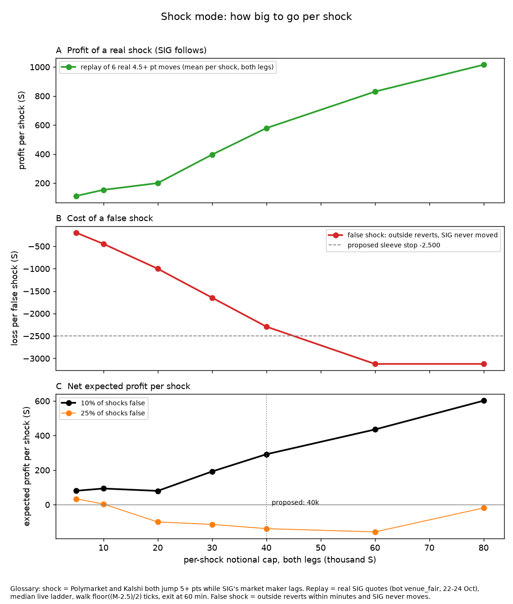

# Shock mode: build note (24 Oct 2026)

Sizhe approved this on 24 Oct, ~08:50 BST: "exempt purpose='shock' trades from the 5,000 partisan cap; build shock mode
under the usual gates". He then added the overnight ideas that tested well: a fast detector, and R3 as an exit option.

* Deliverable: `research_notes/shock_mode_wiring.diff`, which includes the new file `sigbot/proposals/shock_mode.py`.
* Base of the diff: **live 734e9aa** (cash raise + 15k shock reserve 3dd7f8c, wind-down 734e9aa, cheap favourites, the
  strategy monitor). Rebased 24 Oct. Interactions:
  * strategy monitor: `strategy_paused(self, "shock")` gates entries and adds only; exits are never gated;
  * cheap favourites: the two sleeves never share a race; cheapfav counts shock's unfilled entries on its partisan axis;
  * cash raise / reserve: shock sizes from all free cash (`self.cash`, reserve included); every other sleeve uses
    `spendable_cash` (cash minus the reserve). The raise uses `shock_active()` (no refill mid-shock) and `shock_races()`
    (never sells a shocked race), re-read after it takes `trade_lock`. `shock_reserve()` is 0 once shock is stopped,
    paused or past its last entry;
  * wind-down: a race with an open shock is exempt (never sold or cancelled) and shock's own shares are not inventory to
    sell; shock never enters a race the wind-down or the raise clipped in the last 30 min (shared exit lock);
  * shock's spend leaves `self.cash` at once.
  * **With shock on, the 15k reserve is live:** every other sleeve plans with cash minus 15k until the raise refills it.
    The low-cash sims (churn_many_lowcash, cash_raise*, recycle_oversize) pin shock off for that reason.
* Files: config.py, direction.py, mm.py, news.py, proposals/shock_mode.py (new), run.py, venues/polymarket.py,
  tests/sim_pipeline.py, tests/test_guards.py.
* The diff was built in a private copy. The shared tree, config.json and the bot were not touched.
* Evidence: `shock_playbook.md` (section 0 and the read-first summary). Decision plot:
  `figures/shock_mode_decision.png`.



## What it does

**Trigger.** Polymarket and Kalshi both move the same way:
* the blend moves >= 5 pts from its median 45-15 min ago, and each venue moves >= 3 pts;
* the two venues are within 4 pts of each other;
* SIG has copied less than a third of the move;
* **the outside is still at least 3 pts beyond SIG's mid in our direction** (`GAP_MIN`). Added after the live-config day
  replay: a longshot's outside price rose 6 pts only to SIG's standing, overpriced level. SIG had "copied none of the
  move", but there was nothing left to capture. The sleeve lost about 2.9k and hit its stop. The walk, adds and the
  fresh-book re-check all use min(move, gap). On the six real SIG events the rule keeps the three profitable trades and
  skips VA-05 (+97) and Alaska R; the replay total is +1,385, against +1,412 before;
* SIG's spread is <= 4 ticks;
* the race is not in Alaska;
* this is the race's only shock in 6 h, and no other race has a shock open;
* entries stop at 23:30 ET on 2 Nov.

Both legs of the race qualify independently.

**Entry.**
1. Cancel all our resting orders on the race's legs, so there is no self-trade and our MM's stale side cannot be
   picked off.
2. Keep the MM out of the race until the time stop (the existing `news_pause` mechanism).
3. Take SIG's stale side with one 60-s limit order per leg. The walk is floor((M - 2.5 pts) / 2) ticks behind the
   touch, at most 4, where M is the OUTSIDE move, never SIG's static gap. The order is sized from the visible book and
   capped by the per-shock budget.

**Adds.** For 30 min after onset, the bot adds while all three hold:
* the outside move keeps growing;
* the venues still agree;
* SIG has copied less than 50%.

**Exits.** One order per leg in flight. Taker exits have a 15-s TTL, so they retry about every 20 s. Each exit crosses up
to 2 ticks behind the touch, 10 ticks from the 3 Nov flatten. Every exit, taker or maker, is clamped to the position the
venue shows on our side, re-read under the trade lock at most every 3 s while exiting. This was review fix 1: the fills
ledger only moves when the main cycle ingests, and a stale ledger re-sent exits that flipped the position. The rules, in
order:
* flatten at 11:30 ET on 3 Nov;
* close a position that has no entry context (after a restart without the state file);
* close everything once the sleeve has hit its stop;
* 60-min time stop;
* SIG has copied 70% of the move;
* the venues split by more than 8 pts;
* the outside gives back half the move within 30 min (hoax guard).

**R3 maker exit (`shock_exit_maker`).** The exit rests at the price where SIG has copied 70%, so the DMM's walk
crosses it. The taker convergence exit then waits for 85%. Any other exit rule cancels the resting order, and the next
tick takes the bid. A failed cancel means the order may have filled, so taker exits wait 100 s, and the venue clamp
still applies.

**Netted residuals.** Sometimes the ledger shows shock shares that the venue does not hold on our side, because another
sleeve's inventory on the same leg netted them. Once no shock order has been sent on that leg for 180 s (the ledger is
then current), those shares are dropped into `netted`. They are not "closed", which would flip the account.

**Fast detector.** Every `shock_poll_sec` (5 s), one batched Polymarket `POST /midpoints` call on its own client:
* If a leg's midpoint is 3+ pts off every value from 5-15 min ago, the bot runs the full two-venue poll at once (at
  most every 15 s).
* Otherwise it runs that poll every `shock_full_sec` (30 s).
* The full poll is the directional poller's own Polymarket `/books` + Kalshi `/markets` fetch, and trading only ever
  happens on it. So both-venue confirmation is kept: R1 showed SIG ignores single-venue moves.

**Rate budget.**
* Polymarket: 12 light calls/min plus 2-8 full polls/min.
* Kalshi: 2-8/min.
* SIG: SIG prices come from the websocket feed books, so there are no SIG reads in the detection loop. The extra SIG
  calls are:
  * one fills read per cycle, only while a shock is open;
  * one positions read at most every 3 s, only while an exit is due;
  * the orders themselves.

**Partisan cap.**
* Exempt: `shock_tick` never reads it.
* Shock positions are real venue positions, so `risk.exposure` counts them in net D for every other sleeve, and the
  others stay blocked as before.
* The sim's invariants:
  * `adds_to_blocked_direction` exempts shk/shx/shm orders only;
  * the `partisan_cap` bound widens by exactly the shock sleeve's own net D, in its direction.

**Interactions.**
* **Set paths.** The recycler, free unwinds, offload and churn leave shock races alone, the same rule as cheap
  favourites; a single-leg position looks like a set.
* **MM inventory.** Shock positions are excluded from it.
* **Kill switch.** Thresholds are unchanged. The kill switch's drawdown measure leaves out the shock sleeve's own
  marked P&L, read in the same locked snapshot; fills are pulled into the ledger first while a shock is open.
  * Why: walking 2-4 ticks into a shock marks ~-900 at once. That tripped the 400 drawdown kill one minute after every
    entry in the sim, cancelling every order (including the shock's exits) and pausing the MM for 30 min.
  * The sleeve's own stop covers shock risk.
  * **Sizhe should confirm this reading of "kill-switch thresholds stay as they are".**
* **Restart.** The ledger is rebuilt from fills (purposes shock/shock_exit). The entry context comes from
  `params/shock_state.json`. The reference history reloads from `venue_quotes`.

## Proposed config values

```json
"shock_enabled": true,
"shock_per_shock": 40000.0,
"shock_total": 40000.0,
"shock_kill": -2500.0,
"shock_poll_sec": 5.0,
"shock_full_sec": 30.0,
"shock_exit_maker": true
```

The code defaults are: off, 20k / 20k / -1,500, and the maker exit off.

**Why 40k per shock** (panel C; replay of the six 4.5+ pt events with real SIG quotes and the median live ladder; one
race at a time, so `shock_total` = `shock_per_shock`):

| per-shock cap (both legs) | 5k | 20k | 40k | 60k | 80k |
|---|---|---|---|---|---|
| profit per real shock | +111 | +200 | +579 | +830 | +1,015 |
| loss per false shock | -198 | -1,001 | -2,291 | -3,122 | -3,122 |
| net per shock, 10% false | +80 | +80 | +292 | +435 | +601 |
| net per shock, 25% false | +34 | -100 | -139 | -158 | -19 |

* **How often shocks are false.** None of the 7 both-venue 5+ pt jumps of 8-23 Oct gave back half its move within an
  hour (each kept 94-144% at 60 min). None of the four 2024 shocks was a hoax either. So ~10% is the central case, and
  under the max-EV objective that favours a bigger cap.
* **Why stop at 40k.**
  * One race (MT-01) is 68% of the replay's profit.
  * Above ~40k the cap stops binding at the 4-tick walk on a typical book.
  * A 40k false shock (~-2.3k) fits under the -2,500 stop, so one false shock is survivable and a second stops the
    sleeve.
* **Raise to 80k** after two shocks that each made money.
* **Cheap legs are sized smaller.** Shares are sized as if the leg cost at least 0.40 (review 5). On a 0.20 leg a 40k
  cap therefore buys about half the shares the table assumes. The replay's events were 0.38-0.68 legs, so the table is
  unaffected.
* **Expected value to 3 Nov:** 6-8 events expected, at ~+290 each (10% false, 40k), is about **+2k S**. There is a
  fat right tail: the 14-pt sim shock made +4-5k.

**Why the maker exit is on** (Sizhe's rule: only if the sim or replay shows it beats taker exits). Same events, same
seed:

| variant | real 14-pt shock | hoax |
|---|---|---|
| taker | +4,073 | -1,411 |
| maker (DMM walks through our ask) | +4,764 | -1,410 |
| maker, worst case (the DMM is post-only and stops one tick short) | +4,459 | -1,410 |

These are the numbers after all the review fixes, on the rebased tree.

* In the worst case, other takers fill the resting exit.
* This is sim evidence only. SIG's matching of a DMM walk against a resting order has never been observed.
* Watch the first live shock: if the maker exit has not filled by the time stop, set it to false.

## Gates run (private copy)

* `tests/test_guards.py`: ALL PASS. 40+ new checks, including:
  * the cap exemption is shock-only;
  * flatten at 3 Nov 11:30 ET on a fake clock;
  * the stop;
  * per-shock and total caps across adds;
  * a restart mid-position, with and without the state file;
  * the R3 maker exit and its cancel-then-take;
  * the kill switch's shock adjustment read in the same snapshot.
* `tests/sim_pipeline.py`: three new scenarios (`shock`, `shock_maker`, `shock_maker_postonly`):
  * a Polymarket-only jump with Kalshi disagreeing: no entry;
  * a 14-pt both-venue shock with the DMM lagging 2 min, then walking: both legs entered, closed within the hour,
    profit;
  * a hoax that reverts after 8 min: entered, then closed by the hoax guard;
  * flat at the end, caps respected, no kill switch.
* Full sim including `day`: see the run log in the hand-over message. The driver now runs `shock_tick` after each
  scanner pass, as the live thread does.
* Fable adversarial review: see the hand-over message.

## Fable reviews and what they changed

Nine adversarial reviews (five Fable, four Opus) returned NOT SAFE; reviews 9 and 11 returned SAFE TO DEPLOY. Every must-fix is fixed and has a guard test or a stress check.

**Review 1**
* Exits were sized from the lagging fills ledger and re-sent, flipping positions. Every exit is now clamped to the
  venue position.
* A maker exit that filled while its cancel was in flight could be followed by a taker over-close.
* Exits retried only every 90 s. Taker exits now have a 15-s TTL, and the flatten walks 10 ticks.
* Also: a frozen race set for other threads, an own Polymarket client for the fast detector, the outside fetch moved
  outside the direction lock, and `news_pause` written under the store lock.

**Review 2** (the same must-fixes, re-verified).

**Review 3**
* A failed positions read ("{}") was taken as flat and netted a real position. Unknown is now never flat.
* Netting could fire on our own not-yet-ingested exit fills. Netting now requires a successful fresh fills read, and
  the netted amount resets when the leg's ledger is flat.
* The R3 maker was dropped at 540 s without a cancel.
* The kill-switch adjustment is now marked on the venue's own basis.
* Quiet SIG books were invisible to detection. Detection now reads feed books up to 300 s old, and orders re-read the
  book over REST.

**Review 4**
* An entry is now re-checked on the fresh REST book: no entry if SIG has already moved.
* A failed maker cancel is retried every tick, with no taker exit until it is confirmed dead.
* Read status is local to each call (no shared flags).
* An order whose outcome is unknown (timeout) counts against the budget and blocks the race.
* The poll reuses the directional poll's rows when they are under 15 s old.

**Review 5**
* An add whose outcome is unknown now counts in the race's spent, so the cap cannot be breached on a retry.
* Only a 404 on a maker cancel means "gone". A 429 or other error retries. A maker missing from a fresh open-orders
  read counts as gone.
* Shares are sized as if the leg cost at least 0.40, so on cheap legs the entry mark cannot eat the stop.
* Shock mode has its own Kalshi client.
* Flatten falls back to the ledger size after 30 s of unreadable positions.

**Review 6** (Opus 5.5, high effort; approved by Sizhe). It confirmed the rebase broke nothing, and found:
* A failed or earlier open-orders read could make a live maker look gone. Now only a successful read that began after
  the maker was placed counts.
* A 5xx reply, a timeout or a missing orderId is now an unknown outcome:
  * an entry or add counts against the budget and blocks the race;
  * a maker becomes a placeholder until its TTL, or the leg's orders are cancelled when an exit is due.
* Spend is now counted on the 0.40 share floor.
* No entry on a leg where the venue holds the other side. In a race with held arb sets, a shock would otherwise net
  against the set's NO, and the exit clamp would then break the set.
* The last good shock P&L is kept for the kill switch if the ledger read fails.

**Review 7** (Opus): repeated exits could size into other sleeves' same-side shares (an arb set's NO) after a partial
fill the ledger had not seen. Fix: pull fills and re-size before each repeat exit on a leg. Also: 409 counts as an
unknown outcome, a 60-s hold after clean rejects, race orders cleared once per shock, the open-orders stamp set with the
cache, and a loud log if shock is off with positions open.

**Review 8** (Opus): the pull check was shared across legs. It is now per leg (a leg's last exit + 16 s versus the last
pull), and the dead-maker paths stamp the leg. Fills of unknown-outcome orders are now claimed for shock.

**Review 9** (Opus 5.5, high effort, on the e9eef45 base with the live config and shock on): **SAFE TO DEPLOY**, no
must-fix. Afterwards the live-config day replay found the missing gap condition above; the fix went to review 10.

**Review 10** (Opus): the gap fix ratcheted the stored move down on adds, which allowed more adds into a fading outside
and weakened the hoax and convergence exits. Fix (7997dea):
* the stored move only rises;
* a separate `conv` (the most SIG can copy, up to the outside) drives the 70% convergence exit and the R3 maker target;
* the hoax exit keeps the full move.

**Cash and the 15k shock reserve** (Sizhe; built into the cash raise by the hfarb-fix session). Each shock entry or add
is capped at the bot's free cash (`self.cash`, which includes the reserve) minus 50, less what shock already spent in
the same tick. The 0.40 share floor and the per-shock and total caps still apply. Exits are never cash-limited.
* `Bot.shock_active()` is True while shock holds a position or has an entry in flight.
* `Bot.shock_races()` names the races.
* **The cash raise should call both:** don't refill the reserve while a shock is active, and never sell into a shocked
  race.
* With cash at ~1k today, shock trades stay small until the reserve fills.

**Review 12** (Opus, targeted at the cash change, e5ccf8c): **SAFE TO DEPLOY**. Follow-ups:
* reduce `self.cash` by shock spend between cycles: later ticks can count the same cash twice, but the venue shrinks or
  cancels an order that cash can't cover, so the result is a smaller fill, not a loss;
* also reduce the cash left in the unknown-outcome branch.

**Review 14** (Opus, merge onto 06836fe cash raise): SAFE TO DEPLOY. Its should-fix (raise planned before the lock) is done.
**Review 15** (Opus, merge onto 734e9aa wind-down): SAFE TO DEPLOY. Should-fixes: a shock residual stuck past 12:00 ET 3 Nov
keeps its whole race out of the wind-down until it closes (sell around shock_open after 12:00, or alert); the 30-min exit
lock lets a shock enter a race whose wind-down is waiting on timing; cancel_mm_quotes runs cancel_all outside trade_lock
(pre-existing).

**Review 13** (Opus, the rebase onto 9431c1d and the cheapfav / monitor / cash interactions): **SAFE TO DEPLOY**.
Should-fixes: shock can still enter a race in the ~1 cycle after a cheap-favourite entry, before its fill reaches
cheapfav's ledger (no loss: each sleeve closes only its own ledger); value netted residuals at a fixed mark.

**Kill switch (global 400 drawdown):** health() subtracts shock's own marked P&L from equity. The accounting is
consistent (review 13), so shock MTM cannot trip the 400 at any size. Measured at 40k: shock's worst trailing-hour P&L
drop was 2,774 in the shock sim and 1,060 in the day replay; the global drawdown without shock peaked at 46-53. If
shock were counted in the 400 instead, it would have to be sized at ~5k per shock (40k x 400 / 2,774, with margin).

**Review 11** (Opus 5.5, high effort, HEAD 7997dea, live config with shock on): **SAFE TO DEPLOY**, no must-fix.
Should-fixes for the follow-up:
* a rare immediate-loss entry when SIG has already copied much of an 11+ pt move with only a ~3-pt gap left (about
  300-900; fix: skip unless the target is at least a tick beyond entry);
* an unknown-outcome entry stores no `conv`, so it falls back to the full move and the time stop closes it;
* adds on a leg that is exiting in the same tick are kept out only by the stricter fresh-book check (to be made
  explicit).
* Every set path skips shock races: scanner and cycle free unwinds, recycle and its backstop, offload, `arb.plan`, and
  churn sell-all and entries.
* It ran the guards, four sims and the probes from reviews 7 and 8.
* Should-fixes left for a follow-up (none blocks):
  1. a millisecond window in which a fill can be stored without a purpose;
  2. zero-EV exits can touch shock legs that carry old directional, tilt or MM fills (heals next cycle, about one
     spread);
  3. netted shares are still marked at mid in the kill-switch adjustment;
  4. a maker that dies by TTL does not stamp `shock_exit_sent`;
  5. recycle can pick a shock race as its target (a wasted unwind);
  6. switching shock off does not close open positions;
  7. some timing state does not persist across a restart;
  8. an add can self-trade against our own resting maker.
* In the 40k-config sims a single hoax lost about 2,595, about the -2,500 stop. **One false shock can stop the sleeve**
  at 40k. Raise the stop to about -4,000 if one hoax should be survivable.

The reviewers' stress harness (outside the repo) passes 10 of 11. The remaining item is graded LOW: shares netted
against other sleeves' inventory are still marked in the sleeve's own P&L.

## Caveats

* The evidence for big-move lag is n 5-6 SIG events (MT-01 dominant). The sim's DMM walk (1 tick / 30 s) is
  idealised.
* The 2-tick exit walk can leave part of a 40k position unfilled per order. Exits retry about every 20 s, and walk 10
  ticks from 11:30 ET on 3 Nov.
* `news_pause` is shared with the news sweeper (a read-modify-write on one params key; a lost update only shortens a
  pause).
