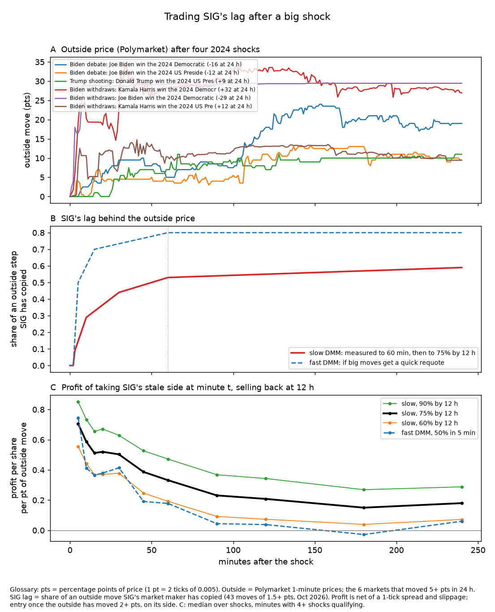
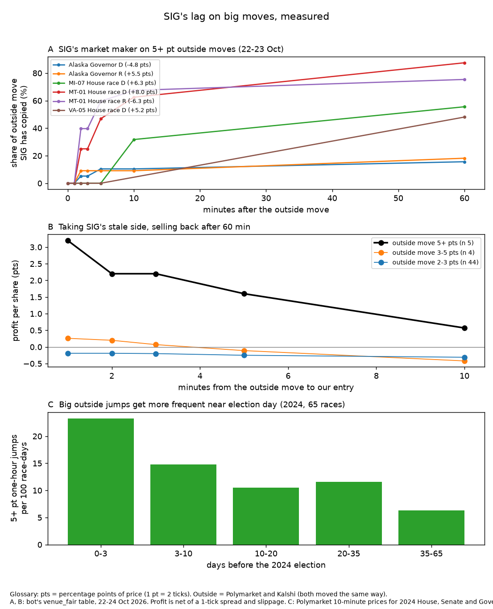

# Shock playbook: trading SIG's lag at maximum EV (24 Oct 2026, overnight side session)

Objective (Sizhe): "if a huge market shift occurs our goal isn't to minimise risk, it's to maximise EV". This note says
what the bot should do in the first 1 / 10 / 60 minutes of a shock. It covers which markets to trade, on which side and
at what size, when to stop, and how the market maker (MM) should behave. It also says what the catch-up sweep already
covers and what would need building (spec only).

Read-only study:
* Nothing under sigbot/, config.json, params/, tests/ or deploy/ was touched. No orders. 0 SIG venue calls.
* SIG depth comes from `data/books_latest.json` (24 Oct 00:01 UTC, 80 books with mid 0.15-0.85).
* Outside data: about 120 public Polymarket calls (gamma + CLOB `prices-history`, 1-minute resolution), cached in
  `data/research_overnight/raw/`.
* Code: `research_notes/overnight_study.py`. Output: `data/research_overnight/results.json`. Figure:
  `research_notes/figures/shock_lag_ev.png`.
* Units: 1 pt = 1 percentage point of price = 2 ticks. S = SUSQies.

*This first figure is model-based, from 2024 paths and the 1.5-pt lag kernel. The measured version is `figures/shock_sig_measured.png` in section 0, and it supersedes this one where they differ.*

## Read this first: overnight summary (24 Oct 00:24-06:24 UTC; Opus analysis, Fable ideas and double-check)

**Shock mode (before 3 Nov)**
* **Build it.** Trigger:
  * a both-venue outside move of 5+ pts, Alaska excluded. SIG ignores single-venue moves: Polymarket-only moves were
    copied 8% by 60 min.
* Entry:
  * Take SIG's stale side at once and walk floor((M - 2.5)/2) ticks (max 4), M = the outside move, never the
    SIG-outside gap.
  * Cancel our MM quotes on both legs first.
* Exit:
  * at ~60 min, or at 70% convergence.
* **Speed is the lever.** Profit per share by entry delay (n 5):

  | entry delay | 1 min | 2 min | 5 min |
  |---|---|---|---|
  | profit per share | +3.2 pts | +2.2 | +1.6 |

  Today's outside poll runs every 69 s by day and 123 s at night. A 5-10 s two-venue poll (Polymarket `/midpoints` +
  Kalshi `/markets?tickers=`) costs < 0.5 s per round.
* **Value:**
  * the realistic replay on six events made +1.4k S (MT-01 is 68% of it);
  * 6-8 such events are expected before 3 Nov (jumps rise 1.4-2.2x near the election and 84% are in competitive
    races);
  * about **+1.5-3.5k S** at today's speed, up to +3-7k with the fast poll and both legs.
* **Not supported:**
  * same-price refills (only 14-24% after a full touch sweep);
  * a "deadband" (it was a selection artefact);
  * the 12-h hold for big moves.

**Election night and the punt (hand-over note in the shared notes folder: `punt-timing-handover.md`)**
* **A 20-35c stage 1 is almost never sellable at 0.85 before stage-2 polls close.** In 2024, winning legs at 0.20-0.45
  at 19:00 ET first reached 0.85 at 22:42-23:00 ET (MI president). The rest came after 00:30 ET, or days later (both
  venues). The count, not SIG, is the bottleneck. Treat the plan's "fair-price stage 2" case as the base case. A late
  stage 2 bought after 23:00 ET resolves by 06:00 ET only ~25% of the time (6 of 25 in 2024).
* **SIG overprices longshots.** Payout per S at SIG's ask: 0.42 under 5c, 0.67 at 5-10c, 0.88 at 10-25c and 0.94 at
  25-35c. The roll still beats a single 7-8c stage by ~30% in P(win). Use a 25c floor for stage legs.
* **Election-night sleeve exit.** SIG's bid sits 2.5-4.3 pts under fair on 0.95-0.99 legs, so `recycle_gap 0.01` never
  fires, and line 462 also needs touch quantity >= position. If the sleeve must recycle cash: `recycle_gap` ~0.035 and
  sell min(qty, touch) per poll.
* **DMM speed on 20-50 pt moves is unknown.** Measure it on the first three calls (19:00-19:30 ET) and scale the
  sleeve's budget (section 7).

**Ideas tested tonight (23 in total, from three Fable rounds and Opus).** Build: shock mode with a fast two-venue
poll. Everything else was dropped or left on paper (new_strategies_overnight.md).

## 0. Update after measuring SIG directly (24 Oct, 00:30-01:00 UTC; supersedes sections 2-4 where they differ)

The sections below model SIG with the lag kernel from 1.5-pt moves. Measured on the bot's own `venue_fair` table
(22-24 Oct, 58 moves of 2+ pts on both venues; `overnight_study.py lag`):

* **Big moves are copied fast; small moves are barely copied at all.**
  * 2-3 pt moves (n 49): SIG copied 0% at 10 min, 12% at 30, 21% at 2 h and ~25% at 4-12 h.
  * 5+ pt moves (n 5, three races): SIG walked its own ladder at **0.2-0.5 pt per minute** with no trades on the
    tape. MT-01 on 22 Oct 04:31 UTC moved +8 pts outside in one poll, and SIG had copied 5 pts by 10 min and 7 by
    60 min. Alaska Governor was the exception: copied 0.5-1 of 5 pts, ever.
* **No deadband; SIG follows changes, not levels (corrected after Fable check, 03:10 UTC).** My first version said SIG "barely copies" 2-3 pt moves and tolerates a ~2.5-3 pt gap. That was mostly my own selection filter (events where SIG had copied < 1/3 at detection). Unfiltered, SIG copies by 60 min: 0.85 pts of 2-2.5 pt moves, 1.9 of 2.5-3.5, 2.4 of 3.5-5 and 4.5 of 5-10, i.e. 40-65% of small moves within 1-4 h. Separately, SIG closes only 0.05-0.12 pt/h of its static gap to fair at any gap size: it copies outside CHANGES, not levels. So size the walk by the outside move, never by the SIG-outside gap. The trigger still sees the filtered sample, so trading numbers are unchanged.
* **Speed is the lever, not holding time.** On 5+ pt moves, buying SIG's stale side and selling at 60 min earned:

  | entry delay | 1 min | 2 min | 5 min |
  |---|---|---|---|
  | profit per share | +3.2 pts (t 3.5) | +2.2 | +1.6 |

  That is roughly 0.5-1 pt per minute of delay. The bot's 60/120-s direction poll gives up 1-2 pts/share. One
  batched Polymarket `POST /midpoints` call covers all 114 races in 64-130 ms, so a 5-10 s shock detector is cheap.
* **Small moves need the long exit.** For 2-3 pt moves, a 60-min exit loses 0.2 pt/share and only the 4-h exit is
  positive (+0.35). The catch-up sweep's exit rules should keep that split.
* **Exit at about 60 min, not 12 h.** SIG has copied most of a big move by then. MT-01 D also reversed -5.5 pts outside
  12 h after its jump.
* **How often:** 7 distinct 5+ pt both-venue jumps in 15.9 days (8-23 Oct, 114 races), about 0.45 a day. Five of them
  fell on 22 Oct, so they cluster. In 2024, one-hour 5+ pt jumps on 65 downballot Polymarket markets came 1.4x as
  often 3-10 days out and 2.2x as often in the last 3 days as 10-20 days out (14.8 and 23.3 vs 10.5 per 100
  race-days; `overnight_study.py jumps`). So about **6-8** such events are expected on SIG before 3 Nov.
* **No same-price refill after a full sweep.** On the 22 Oct feed recording, after a print took the whole touch, the
  same price came back within 20 s only 14-24% of the time (33 of 139, minus feed-ordering artefacts). 73% of the time the touch moved a tick away.
  The "ladder holds" column below therefore means walking the visible ladder once, not re-sweeping refills.
* **Realistic replay:** Realistic replay of shock mode on the six 4.5+ pt SIG events (22-23 Oct; entry at the bot's own venue_fair poll, SIG ask/bid from the table, median live ladder, exit at the 60-min bid, walk cost charged in and out). Totals: touch only +344 S; walk <=1 tick +887; <=2 ticks +1,353; walk floor((M-2.5)/2) ticks, max 4: +1,411 (best). Walking by the TOTAL SIG-outside gap instead (it includes static compression) walked MI-07 6 ticks/350k shares and lost -6.5k. Alaska Governor loses whenever we walk (SIG never follows): exclude AK. ~+230 S per event per leg at today's detection speed -> shock mode ~+1.5-3.5k S to 3 Nov (central), more with the 5-s detector and both legs.
* **Revised central EV per 5+ pt shock:** about 2-3 pts/share on ~20k shares per leg (walk up to 2 ticks), two legs.
  That is **+0.5-1k S per event, or about +1.5-3.5k S to 3 Nov at today's detection speed (up to +3-7k with a 5-s detector and both legs)**, if the bot enters within ~1 min. With today's 1-2 min
  detection it is about half that.
* **Election night:** if the DMM walks at a capped 0.2-0.5 pt/min, a 30-pt call takes it 60-150 min to copy. That is
  slower than the election-night simulation's kernel (29% at 10 min), so the sleeve's +17k is probably conservative
  (n 5, unverified for 20+ pt moves).

## 1. How fast real shocks repriced outside (Polymarket, 1-minute)

| shock (UTC onset) | market | before | 24-h move | peak (min) | 50% of 24-h move by | 90% by | 1 / 5 / 10 / 30 / 60 / 240 min (pts) |
|---|---|---|---|---|---|---|---|
| Biden withdraws (21 Jul 2024 17:46) | Harris D nominee | 0.53 | +31.6 | +34.6 (34) | **5 min** | 31 min | 0.8 / 19.1 / 20.3 / 22.6 / 28.1 / 26.9 |
| | Biden D nominee | 0.30 | -29.3 | -29.4 (95) | **3 min** | 8 min | -2.5 / -16.5 / -29.0 / -28.8 / -29.3 / -29.4 |
| | Harris wins presidency | 0.18 | +11.6 | +14.7 (41) | 5 min | 6 min | -0.1 / 8.8 / 10.5 / 8.4 / 10.3 / 9.4 |
| Biden debate (28 Jun 2024 01:00) | Biden D nominee | 0.91 | -16.0 | **-32.0 (380)** | 26 min | 113 min | 0 / 0 / -2.5 / -9.5 / -5.0 / -19.0 |
| | Biden wins presidency | 0.33 | -11.5 | -18.0 (690) | 16 min | 109 min | 0 / 4.0 / 0 / -4.5 / -4.0 / -9.5 |
| | Trump wins presidency | 0.61 | +2.0 | **+8.5 (47)** | 16 min | 18 min | 0 / 0 / 0.5 / 6.0 / 8.0 / 3.0 |
| Trump shooting (13 Jul 2024 22:11) | Trump wins presidency | 0.60 | +9.0 | +12.5 (476) | 27 min | 62 min | 0 / 0 / 0 / 4.0 / 7.0 / 11.0 |
| NC Robinson story (19 Sep 2024) | NC Gov R | 0.10 | -2.5 | | | | already priced in before the story ran |

What this means:
* **Clean, unambiguous news** (a withdrawal or death) reprices the outside venues in **3-5 minutes**, with little
  overshoot (+3 pts, gone within the hour).
* **Interpretive news** (a debate, an attack, a poll) takes **15-30 min to reach half its move and 1-2 h to reach 90%**.
  It can overshoot badly: Trump presidency +8.5 at 47 min was +2 at 24 h, and Biden nominee was -32 at 6 h but -16 at 24 h.
* **Correlated markets move little and late.** The chamber-control markets moved 0.05-0.6 times the shocked market's
  move (in log-odds), mostly hours later, on thin books. A race-specific scandal (NC Governor) did not move the
  presidential market at all.
* SIG has **no chamber market** (hft_tactics_2.md E). Its other races do not follow each other either (pairs test:
  +0.02, t 0.4). So the tradeable correlated market is the **other leg of the same race**, not other races.

## 2. SIG's lag, and what trading it earns (panel B, panel C)

SIG's designated market maker (DMM) copies an outside move as follows. Measured on 43 moves of 1.5+ pts (bot_exploits.md):
0% at 1-2 min, 9% at 3 min, 29% at 10, 44% at 30, 53% at 60. Nothing is measured beyond 60 min; I assume 75% by
12 h, with 60% and 90% as the low and high cases. Each 2024 path was run through this kernel. Model SIG mid = the
pre-shock level plus each outside 1-minute step × lag(its age). The trade is entered at minute t on the side of the
outside move (only once it is 2+ pts) and sold back at 12 h. Costs: a 1-tick spread plus 0.1 tick of slippage.

| entry minute | 5 | 10 | 30 | 60 | 120 |
|---|---|---|---|---|---|
| profit per share per pt of 12-h outside move, model (75% case) | 0.71 | 0.59 | 0.50 | 0.33 | 0.21 |
| low (60%) / high (90%) | 0.56 / 0.85 | 0.44 / 0.73 | 0.38 / 0.63 | 0.19 / 0.47 | 0.07 / 0.34 |
| "fast DMM" (copies 50% in 5 min, untested for big moves) | 0.75 | 0.41 | 0.41 | 0.18 | 0.04 |
| paths qualifying (of 6) | 4 | 4 | 6 | 6 | 6 |

* **Positive on every path at every entry time up to 4 h**, including the debate overshoot. We buy at SIG's stale
  price, and SIG later copies whatever the outside actually did, so a partial overshoot still leaves a profit.
* **Calibration against SIG's own outside moves** (outside_stable_sweep.md): the immediate follow realised +1.46 ticks
  on 2-pt moves (n 25), +2.65 on 3-pt (n 8) and +4.9 on 5-pt (n 2). That is about **0.37-0.49 pt per pt of move**,
  against the model's 0.73 for entry within 2 min. The central case below therefore scales the model by **0.6**.
* **Capture decays fast after 10 min, and the first 10 min are worth the most.** Waiting for confirmation costs more
  than it filters. This is the same finding as outside_stable_sweep section 10 (optimal wait x = 0).

## 3. Size: depth is not the limit, cash and caps are

SIG ladder depth from the live books (median ask side, mid 0.15-0.85):

| ticks behind the touch | 0 | 1 | 2 | 4 | 6 | 10 |
|---|---|---|---|---|---|---|
| cumulative shares | 2.1k | 7.6k | 19k | 94k | 353k | 1.07M |

* ~~The DMM refills a swept level at the same price in 3.7 s, so a stale touch can be swept again and again.~~
  Refuted in section 0: after a full touch sweep, the same price came back within 20 s only 24% of the time.
* **Rule:** buy every level up to **j_max ≈ 0.35 × M ticks** behind the touch, where M is the outside move in pts.
  This holds for entry within 10 min, central case. Each level costs about j ticks in and j ticks out, and the edge is
  0.6 × 0.59 × M pts. Re-sweep refills while the outside holds. Stop at the per-shock cash cap.
* Each race has **two legs**, D and R, with separate DMM books. Trade both: buy YES on the rising leg and sell YES on the
  falling one. A sold YES needs only 1 - p of collateral. This roughly doubles capacity.

**Expected profit per shock, one leg, entry within 10 min, exit at 12 h (S).** In the "ladder holds" column the DMM
refills as measured. In the "ladder pulls" column only the levels within 2 ticks fill once.

| outside move M | cash cap | central: ladder holds | central: ladder pulls | model (uncalibrated): holds |
|---|---|---|---|---|
| 5 pts | any | +0.1k (8k shares) | +0.1k | +0.4k |
| 10 pts | 25k | +0.5k (19k sh) | +0.5k | +1.8k |
| 10 pts | 50k | +0.5k | +0.5k | +3.1k (94k sh) |
| 20 pts | 25k | +2.4k (50k sh) | +1.2k | +4.7k |
| 20 pts | 50k | **+4.3k (100k sh)** | +1.2k | **+9.0k** |
| 20 pts, entry within 2 min | 50k | +6.0k | +1.5k | +11.9k |

Two legs: multiply by about 1.5-2 for 10+ pt shocks.

**How often.** Before 3 Nov:
* Outside moves on SIG races (both venues agreeing) ran at 14 moves of 3+ pts and 2 of 5+ pts in about 15 days
  (outside_stable_sweep).
* A 10-20 pt unscheduled shock in a SIG race in the 9 days left is perhaps a 20-40% event (a withdrawal, a death, a
  major scandal or a ruling).
* Expected value of being ready: **about +0.5-1.5k S before 3 Nov**, with a fat right tail (+5-20k if a 20+ pt shock
  hits a race with two legs and we have 50k free).
* The cash costs nothing to hold ready. Under the cash objective it sits idle anyway (no new holds since 23 Oct), and a
  shock trade turns back into cash within 12 h.

## 4. The playbook

**Trigger.** Polymarket and Kalshi both move the same way:
* the blend moves **>= 5 pts** from its 30-min median, each venue >= 3 pts;
* the two venues are within 4 pts of each other;
* SIG's mid has copied less than a third of the move.

Under 5 pts, the existing catch-up sweep handles it as now.

**Minute 0-1 (the first poll that sees it)**
1. Cancel **all our MM quotes on both legs** of the shocked race. This avoids self-trades, and our own stale ask (on
   the rising leg) or bid (on the falling leg) would otherwise be picked off.
2. Sweep the stale side of both legs at once. Size the walk by the OUTSIDE MOVE, never by the total SIG-outside gap (which includes static compression): j_max = floor((M - 2.5) / 2) ticks, max 4 (section 0 replay; the 0.35 × M rule below is superseded), capped by the per-shock cash cap
   (ask: **50k**; 25k gets about half the 20-pt EV). Do not wait for "stabilisation": every minute of waiting costs about
   2-3% of the edge in the first 10 min.
3. Do not touch other races. They do not move on SIG, and outside they move 0.05-0.15× for national news, too little to
   pay the spread.

**Minute 1-10**
4. **Pyramid.** At every poll (go to a 10-s poll on the shocked race while a shock is open), recompute M and the target
   size, and add if M grew. Interpretive news reaches half its move only after 15-30 min, so most size goes on in this
   window.
5. Take refilled levels at the same stale price if they reappear (only about 1 in 4 does), until the target is reached or SIG's mid has copied 1/3 of the move.
6. **Hoax guard.** If both venues give back more than half of M within 30 min of onset, exit everything at once.

**Minute 10-60**
7. Stop adding once SIG has copied 50% of the gap or 60 min have passed. By then the edge is under 0.33 pt per pt of
   move, about the cost of walking 2+ ticks.
8. MM on the shocked race: re-quote only around the **outside fair**, never SIG's stale mid. On the rising leg, a resting
   bid near the stale level is fine (nobody sells to us cheaply). The stale ask is the side to keep pulled.

**Exit (about 60 min on 5+ pt moves; see section 0)**
9. Sell back passively. Rest the exit at the level SIG is converging to (outside fair minus 1-2 pts). Take any bid once
   SIG has copied 75% of the gap. Hard stops: 60 min for 5+ pt moves (4 h for smaller ones), or 12:00 ET 3 Nov (all cash for the punt), whichever comes first.
   A 24-h hold adds little; the 60-min-plus lag is unmeasured.

**Caps and kill switch**
* **Partisan cap 5,000.** A shock trade is a lag trade, not a partisan view, and the cap blocks 50-85% of the EV
  (outside_stable_sweep section 6). Ask Sizhe to exempt `purpose='shock'` from it, as proposed for `purpose='election'`,
  with its own cap: 50k per shock and one shock open at a time.
* **Kill switch.** Exit everything if the sleeve is down 3k S, or if the hoax guard fires. The global kill switch stays
  as is.
* **Cash ready.** Keep >= 50k liquid from now to 3 Nov 12:00 ET. Under the cash objective this is already true.

**Interaction with the punt and election night**
* **Election night is the biggest shock of all, and it is already planned.** The `election_night.py` sleeve (paper)
  trades SIG's lag on 20-50 pt moves after poll closes: +17k central on 90k (election_night.md). It competes with the
  punt for the same cash. Sizhe should decide the split; per susqie of cash, the sleeve earns about 19% (central).
* **A shock in a punt-candidate race before 3 Nov** changes the punt's odds. Re-run `punt_screener.py` after any
  shock of 10+ pts.
* After 12:00 ET 3 Nov the shock sleeve is off, and the election-night sleeve and punt executor take over.

## 5. What exists and what would need building

The catch-up sweep (`sigbot/proposals/outside_sweep.py`, live) already covers:
* the trigger: both venues, 2+ pts in 60 min, SIG followed less than 1/3;
* immediate entry with no wait;
* exit at 70% convergence;
* the 3 Nov flat-by rule;
* a kill switch.

It captures a shock at about 1% of the max-EV size:
* 300 notional per leg, at most 4 positions, -50 kill;
* the touch only (spread limit 2 ticks);
* subject to the partisan cap;
* a 60/120-s poll;
* no pyramiding, no hoax guard, no MM cancel.

**Spec: "shock mode" on top of the catch-up sweep** (not built; needs the normal gate: tests, a sim scenario, a Fable
review and a botctl deploy):
1. Trigger M >= 5 pts as in section 4, Alaska excluded. Entry j_max = floor((M - 2.5) / 2) ticks, max 4, M = outside move (not the SIG gap), target notional = min(per-shock cap, j_max
   ladder depth).
2. Both legs of the race, with an orientation check (D-leg YES up means R-leg YES down).
3. Cancel MM orders on both legs before the first sweep, and stop the MM from quoting them while the shock is open.
4. A 10-s outside poll for the shocked race while open. Pyramid on M growth for up to 60 min.
5. Hoax guard: half of M given back within 30 min means exit. Sleeve kill at -3k. One shock at a time.
6. `purpose='shock'`, exempt from the partisan cap with its own 50k cap (Sizhe's decision).
7. Exit: rest at the outside fair minus 1.5 pts; take bids at 75% convergence. Stops at 60 min (5+ pt moves) and at 12:00 ET 3 Nov. Add a 5-10 s Polymarket `/midpoints` batch poll as the shock detector.
8. Sim tests:
   * a withdrawal path (30 pts in 5 min);
   * a debate path (overshoot then half retrace);
   * a hoax (reversal in 10 min);
   * the DMM pulls after a sweep;
   * a restart mid-shock.

## 6. Caveats

* The sample is four 2024 shocks and six paths, all national. A downballot race's outside books are thinner and its
  moves noisier. The SIG-side calibration (0.6) rests on 10 SIG moves of 3+ pts.
* SIG's lag beyond 60 min, and its behaviour on a 10+ pt move, have never been observed; every measurement is of 1.5-5
  pt moves. If the DMM has a manual "big news" requote, the "fast DMM" row applies. Entry in the first 5 min still pays
  then, so speed matters more than size.
* After our sweep the DMM's requote hazard rises tenfold (hft_tactics_2 A). The "ladder pulls" column is the floor for
  that case.
* Only Polymarket was used for the 2024 paths. Kalshi's 2024 minute history was not pulled (token budget).

## 7. Election night: capped walk vs the sleeve's kernel (24 Oct, 00:40 UTC)

Stale-gap area (pts × minutes over 4 h) a lag trader can harvest after one outside call move:

| outside move | sim kernel (29% at 10 min) | walk 0.2 pt/min | walk 0.5 | walk 1.0 |
|---|---|---|---|---|
| 20 pts | 766 | 1,050 | 450 | 250 |
| 30 pts | 1,149 | 2,325 | 975 | 525 |
| 50 pts | 1,915 | 6,362 | 2,625 | 1,375 |

* MT-01 walked at about 0.5 pt/min. At 0.2-0.5 pt/min the sleeve's EV is about the same as its simulation's or up to
  ~2x higher. If the DMM speeds up to 1+ pt/min on the night, it is about half.
* **Weakened (Fable check):** the "capped walk" rests on 4 events, and one race (MT-01, D and R legs) dominates. Do not
  plan on it. Measure it on the night (rule below).
* **Rule for 3 Nov:** measure the DMM's walk speed on the first three called races (19:00-19:30 ET) and scale the
  sleeve's budget by the gap-area ratio above.

## 8. The punt's roll: stage 1 is not sellable in time (24 Oct, 01:55 UTC)

Fable's idea of a "sellability clock" for stage 1 → stage 2 pairs, tested on 2024 Polymarket 1-minute paths for winning
legs (`overnight_study.py`, inline test):

| winning leg's price at 19:00 ET | n | when the outside price first reached 0.85 (ET) | with SIG walking 0.5 pt/min |
|---|---|---|---|
| 0.20-0.45 | 8 | MI president 22:42; NY-19 and PA Senate 01:24; WA-03 days later; CA-22, CA-27, CA-45 and PA-10 not that night | +0-60 min later |
| 0.45-0.70 | 16 | OH Senate 19:48; GA, NC and DC president 20:06-20:36; the rest 22:12 or later, or not that night | +0-60 min later |

* A 20-35c stage 1 that wins is almost never sellable at 0.85 before 22:30 ET. The bottleneck is the count, not SIG's
  lag.
* Stage-2 candidates (NE Gov, KS Gov, MN-01, LA Sen) close at 20:00-21:00 ET and will be counting by then. So
  punt_strategy.md's "slow count, stage 2 is a fair-price bet" case (its 50% haircut column) should be treated as the
  **base case**, not the downside.
* Options for the punt owner:
  * pick stage 2 among races that are still uncertain after ~23:00 ET but get called that night;
  * accept stage 2 as a fair-price bet;
  * compare against a single-stage punt at the same target.

  This is Sizhe's call. A hand-over note is in the shared notes folder.

Other round-2 ideas (Fable), tested:

| idea | test | result | verdict |
|---|---|---|---|
| Stage 2 = a leg whose outside price ran 15+ pts ahead of a walking SIG (SIG 0.15-0.35) | 2024 replay, walk 0.2/0.5/1 pt/min | 7-9 qualifiers; 1 of 8 won (11-14%); each S returned 0.58-0.80. Early-return spikes on underdogs were mirages | **drop** |
| "Lag tickets": all cash into called races while SIG still asks 0.6-0.8, before stage 1 | same replay, by 24:00 ET | only 1-2 per night (1.27-1.43x, all won). Too few to replace stage 1; already the election-night sleeve's "calls" slice | **drop** for the punt |
| Buy stage 1 early (by 14:00 ET) | 2024 legs at 0.20-0.40, 16:30 → 18:55 ET | moved a median ±4 pts (max 15.5) with no direction (median -0.5) | **drop** |
| Stage-1 order as one capped limit order vs touch tranches | refill study | the touch re-centres 73% of the time after a full sweep, so one capped order taking the visible ladder | executor detail (paper) |
| Rival-punt detector from public sweeps | needs aggressor-tagged tape on 3 Nov | | **paper** |

* 2024 races still uncertain at 23:00 ET (winner at 0.25-0.75 outside; n 25) that reached 0.95 by 06:00 ET: 6 (NY-19 01:24, IN Sen 02:06, MS Sen 02:36, NY-04 02:54, PA Sen 03:24, WI Sen 05:42 ET); by 11:00 ET 10. Never that morning: all CA/OR/WA/AK House, NY-17, PA-10, IA-03, ME and VA Senate, ND Gov. The 23:00 ET underdog won 10 of 25. So a late stage 2 (bought ~23:00-01:30 ET) resolves in time only ~25-40% of the time; prefer East/Midwest Senate-type races with fast counts.
* SIG overprices longshots (venue_fair latest, 212 legs, both venues). Expected payout per S bought at SIG ask (outside fair / ask): fair <5c 0.42, 5-10c 0.67, 10-15c 0.88, 15-25c 0.88, 25-35c 0.94, 35-50c 0.95, 50-90c 1.01, >90c 1.03. So a single-stage 13x punt on a 7-8c leg keeps ~0.67 of its fair win chance; a two-stage roll at 25-35c keeps ~0.94 x 0.95 = ~0.89 even with stage 2 a plain fair bet. The roll still beats a single-stage punt by ~30% in P(win) on pricing alone, despite the timing finding.

* **Sleeve exit check (24 Oct 02:20 UTC):** Election-night sleeve exit: on near-certain legs today SIG bid sits below the outside fair by a median 2.9 pts (fair 0.90-0.95, n 21), 3.4 (0.95-0.97, n 22), 2.5 (0.97-0.98, n 10), 4.3 (0.98-0.99, n 13); 0 of 45 legs at fair >= 0.95 have the bid within 1 pt. election_night.py recycle_gap = 0.01 would therefore almost never fire, so called holds lock cash to settlement. If the sleeve must recycle cash on the night (it shares cash with the punt), set recycle_gap ~0.035, i.e. sell called holds at fair - 3.5 pts. Not changed here (bot file).
* Kalshi check of the punt timing (2024, winning legs at 0.20-0.45 at 19:00 ET, n 9): first >= 0.85 at 23:00 ET (MI president), then IA-01 00:30, PA Sen 01:06, CA-45 02:06, NE-02 04:06, NY-19 04:48 ET, PA-08 and WA-03 days later, CA-13 never that night. Confirms the Polymarket result.

* **Fable double-check (03:10 UTC) of tonight's claims:**
  * **Confirmed:**
    * entry at 1/2/5 min after a 5+ pt move earns +3.2/+2.2/+1.6 pts per share;
    * the realistic replay's +1.4k;
    * the refill rate, corrected to 14-24%;
    * the punt timing (Polymarket has no stale gaps; Kalshi paths are sparse, so its crossings are upper bounds;
      drop the CO-08 glitch);
    * longshot overpricing;
    * the sleeve's bid gap.
  * **Caveats:**
    * MT-01 D and R are one event (per race n 4, mean +2.7 pts); MT-01 D alone is 68% of the replay's +1.4k.
    * The 60-min exit was chosen in-sample.
    * "1 min" means the first poll that saw the move (0-131 s after it).
  * **Outside prices are longshot-biased too.** In 2024 at 19:00 ET, 5-25c legs won 1 of 27 (Polymarket) and 0 of 28
    (Kalshi), against a mean price of ~0.13; 25-50c legs won 7 of 24, against 0.36. The roll still beats a single 7-8c
    stage, but every P(win) is lower than the screener says.
  * **Sleeve recycling has a second blocker:** `election_night.py` line 462 also requires the touch quantity to be at
    least the position size, so a 20k hold never recycles into a 2k touch. Fix: `recycle_gap` ~0.035, and sell
    min(qty, touch) per poll.
* Where shocks happen (2024, 65 PM downballot races, 1-h 5+ pt jumps per 100 race-days): competitive 0.25-0.75 28.7, lean 0.10-0.25/0.75-0.90 7.8, safe 0.8 (84% of jumps in competitive races; single-venue noise inflates absolute rates). Focus the shock detector, pre-cleared caps and orientation checks on the ~25 SIG races with a leg at 0.25-0.75.
* Lag curve with and without the selection filter (overnight_study.py lagall; venue_fair to 03:35 UTC; median share copied, measured from 60 min before detection, at 10 / 60 / 240 / 720 min). Filtered (SIG < 1/3 at detection): 2-3 pt moves (n 51) 0 / 0.12 / 0.25 / 0.24; 5+ (n 5) 0.68 / 0.87 / 0.92. Unfiltered: 2-3 pt (n 58) 0.21 / 0.25 / 0.30 / 0.24; 3-5 pt (n 8) 0.53 / 0.66 / 0.66 / 0.91; 5+ (n 4) 0.72 / 0.72 / 0.87. Medians are lower than the Fable check's means, but the conclusion stands: copying grows with move size, and the trigger sees the filtered curve.
* Punt price band (2024 Polymarket at 19:00 ET, all legs, one correlated night, so weak evidence): legs < 25c won 0 of 94 (0-5c 0/66, 5-10c 0/10, 10-15c 0/8, 15-25c 0/10); 25-35c won 4/10 (price 0.30); 35-50c 6/17 (0.43); 50-70c 13/20 (0.60); 70-90c 21/23 (0.81). Times SIG markup by band (0.42-0.88 below 25c, ~0.94 at 25-35c), legs under 25c are the worst true win chance per S. Suggest a 25c floor on punt stage legs (plan says 20-35c).
* Correction (2022 check): on 2022 election night (Polymarket AMM, 54 legs, 24 h before 19:00 ET) legs < 25c won 2/17 (11.8% vs price 10.8%), 25-50c 5/10 (vs 0.40), 50-75c 5/10 (vs 0.60), 75c+ 15/17 (vs 0.89): calibrated. So 2024's "0 of 94 under 25c" was one correlated night, not a stable outside bias (this also weakens the Fable-check point that outside prices are longshot-biased). The 25c floor rests on SIG's structural markup alone (true win per S at SIG ask 0.88 at 15-25c vs 0.94 at 25-35c; 0.42-0.67 under 10c).
* Shock-detector feed: Polymarket POST clob /midpoints (114 tokens, 64-130 ms) + Kalshi GET trade-api/v2/markets?tickers=<114> (one call, 74-395 ms, 225 kB). Both venues in two calls < 0.5 s, so a 5-10 s two-venue poll is cheap (public endpoints). Trigger only on both-venue moves: SIG ignores single-venue moves (Polymarket-only copied 8% by 60 min).
